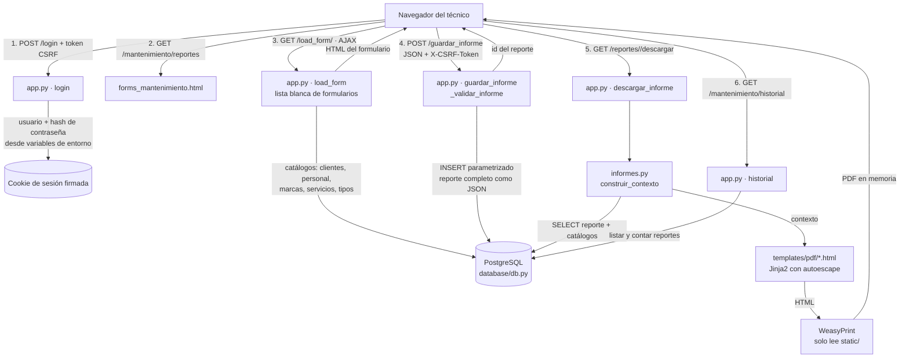
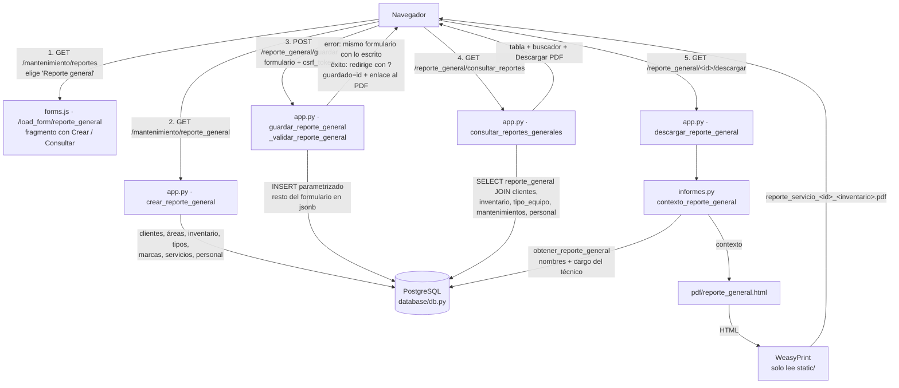
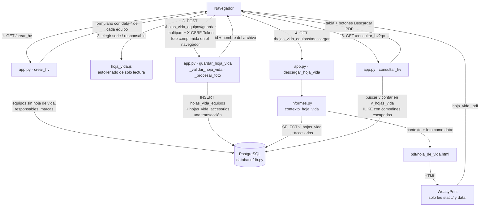
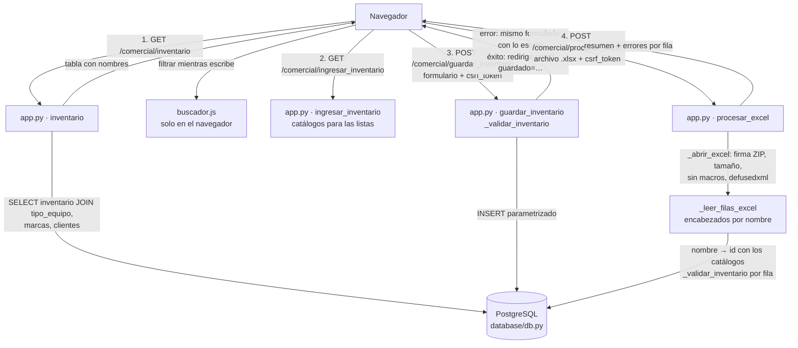
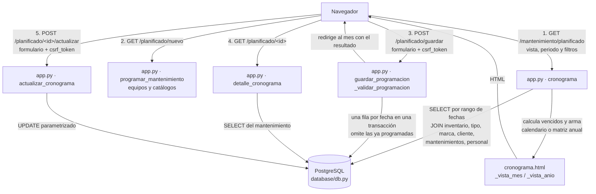
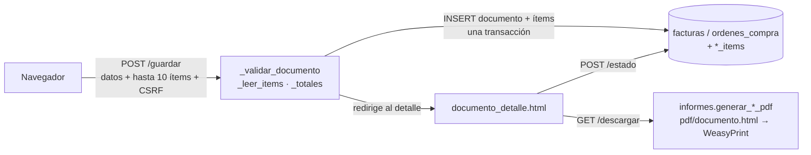
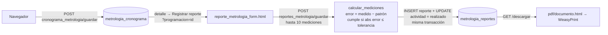

# SISEM — Sistema Integrado de Seguimiento de Equipos Médicos

Aplicación Flask para registrar mantenimientos de equipos biomédicos, reportes generales de servicio y
las hojas de vida de los equipos (con descarga de los tres documentos en PDF), para gestionar el
inventario de equipos, ya sea uno por uno o cargando un archivo Excel, y para planear los mantenimientos
en un cronograma mensual y anual.

También cubre:
- **Comercial:** facturación interna y órdenes de compra.
- **Talento humano:** empleados, roles y permisos, cuentas de cobro y nómina.
- **Laboratorio:** cronograma y reportes de metrología.

Todos estos documentos se descargan en PDF. Hay **dos roles**: el **administrador**, definido en las
variables de entorno, y el **funcionario**, que es cada persona de la tabla `personal` con acceso habilitado.

## Estructura del proyecto

```text
SISEM_PROJECT/
├── app.py                      # Aplicación Flask: configuración, seguridad (sesión, CSRF, cabeceras,
│                               #   límite de intentos de login), manejo de errores y todas las rutas.
│                               #   Valida antes de guardar:
│                               #   · reportes (_validar_informe);
│                               #   · hojas de vida (_validar_hoja_vida, _procesar_foto);
│                               #   · inventario manual (_validar_inventario);
│                               #   · carga de inventario por Excel (_abrir_excel, _leer_filas_excel,
│                               #     _fila_excel_a_formulario, procesar_excel);
│                               #   · cronograma (_validar_programacion, actualizar_cronograma);
│                               #   · reporte general (_validar_reporte_general, _pagina_reporte_general).
│                               #   Roles: login de admin (entorno) y de funcionarios (tabla personal),
│                               #   _sesion_vigente (revalida al funcionario en cada petición),
│                               #   @login_required, @solo_admin / rol_requerido, PERMISOS.
│                               #   Módulos: _Formulario (validación común), facturación y órdenes
│                               #   (_leer_items, _totales), empleados y acceso, cuentas de cobro,
│                               #   nómina (liquidar_nomina), metrología (calcular_mediciones), Mi cuenta.
├── requirements.txt            # Dependencias de Python con versión fija (formato paquete==versión).
├── Dockerfile                  # Imagen para Render: Python + librerías de sistema de WeasyPrint (Pango),
│                               #   usuario sin privilegios y arranque con gunicorn.
├── render.yaml                 # Blueprint de Render: servicio Docker, /healthz y variables de entorno.
├── Procfile                    # Arranque con gunicorn para plataformas sin Docker (Render no lo usa).
├── .env.example                # Plantilla de variables de entorno (copiar a .env y completar).
├── .env                        # Variables reales (secretos). Solo local; NUNCA se sube al repositorio.
├── .gitignore / .dockerignore  # Archivos que no van a git / a la imagen Docker (.env, venv, cachés…).
│
├── database/
│   ├── __init__.py             # Marca la carpeta como paquete de Python.
│   ├── db.py                   # Acceso a PostgreSQL con pool de conexiones (psycopg). Lee DATABASE_URL o
│   │                           #   db_host/db_user/…
│   │                           #   · Catálogos: clientes, personal, marcas, servicios, tipos de equipo,
│   │                           #     riesgos, áreas clínicas.
│   │                           #   · Reportes: guardar, leer, listar, contar.
│   │                           #   · Hojas de vida: equipos sin hoja de vida, responsables, guardar
│   │                           #     (hoja + accesorios en una transacción), leer, buscar y contar.
│   │                           #   · Inventario: listado con los nombres de tipo, marca y cliente (JOIN) y
│   │                           #     guardar_inventario (lanza InventarioDuplicado si la serie ya existe).
│   │                           #   · Cronograma: equipos programables, consulta por rango de fechas y filtros,
│   │                           #     programar (varias fechas en una transacción, sin duplicar) y actualizar.
│   │                           #   · Reporte general: guardar (informacion como jsonb), listar con nombres
│   │                           #     (JOIN) y leer uno para el PDF.
│   │                           #   · Personal y acceso: acceso_personal, estado_acceso, empleados,
│   │                           #     guardar_empleado, configurar_acceso, cambiar_clave (la clave nunca sale
│   │                           #     hacia las plantillas).
│   │                           #   · Facturas y órdenes: guardar_documento (documento + ítems en una
│   │                           #     transacción), obtener, listar y cambiar estado.
│   │                           #   · Cuentas de cobro y nómina (filtradas por empleado para el funcionario).
│   │                           #   · Metrología: programar, consultar, actualizar y guardar reportes (marca la
│   │                           #     actividad como realizada en la misma transacción).
│   │                           #   · resumen_pendientes: contadores del panel principal.
│   └── postgres/               # Migración de MariaDB a PostgreSQL
│       ├── LEEME.md            # Guía paso a paso de la migración.
│       ├── 00_tipos_en_mariadb.sql   # Consulta los tipos reales de columnas en MariaDB.
│       ├── 01_esquema.sql            # Crea las tablas, claves foráneas e índices en PostgreSQL
│       │                             #   (no incluye las tablas de hojas de vida; ver "Base de datos").
│       ├── 02_ajustar_secuencias.sql # Ajusta los autonuméricos después de copiar los datos.
│       ├── 03_verificar.sql          # Cuenta filas por tabla para comparar ambos motores.
│       └── 04_roles_y_modulos.sql    # Columnas de acceso en personal y tablas de facturación, órdenes,
│                                     #   cuentas de cobro, nómina y metrología (solo agrega; re-ejecutable).
│
├── informes/
│   ├── __init__.py             # Marca la carpeta como paquete de Python.
│   └── informes.py             # Generación de los PDF:
│                               #   · Reportes: registro de tipos de equipo (TIPOS_EQUIPO), lectura del
│                               #     reporte, cálculos (bomba, flujos y O2 del concentrador) y lectura de
│                               #     formularios para la plantilla genérica.
│                               #   · Hoja de vida: contexto_hoja_vida, generar_hoja_vida_pdf y el nombre
│                               #     seguro del archivo (hoja_vida_<inventario>.pdf).
│                               #   · Reporte general: FORMATO_REPORTE_GENERAL (empresa, logo, código,
│                               #     versión y fechas del formato), contexto_reporte_general,
│                               #     generar_reporte_general_pdf y el nombre del archivo
│                               #     (reporte_servicio_<id>_<inventario>.pdf).
│                               #   · Documentos administrativos: EMPRESA_DOCUMENTOS, numero_documento
│                               #     (FAC-000001, OC-, CC-, NOM-, MET-), pesos ($ 1.234,50) y
│                               #     generar_factura/orden/cuenta_cobro/nomina/metrologia_pdf.
│                               #   · _html_a_pdf: conversión HTML → PDF con WeasyPrint, que solo puede
│                               #     leer archivos de static/ (ni internet ni otros archivos del servidor).
│
├── templates/                  # Plantillas Jinja2 (HTML)
│   ├── login.html              # Inicio de sesión (con token CSRF) para admin y funcionarios.
│   ├── dashboard.html          # Panel principal: reportes, clientes y pendientes según el rol
│   │                           #   (metrología vencida, cuentas de cobro, facturas, órdenes).
│   ├── cuenta.html             # Mi cuenta: datos del usuario y cambio de contraseña (funcionario).
│   ├── _macros.html            # Macros comunes: etiqueta de estado, avisos y opciones de listas.
│   ├── clientes.html           # Listado de clientes registrados.
│   ├── historial.html          # Listado paginado de reportes con botón para descargar el PDF.
│   ├── proximamente.html       # Página para los módulos del menú que aún no existen.
│   ├── error.html              # Página de error amigable (sin detalles internos).
│   ├── layout/
│   │   ├── base.html           # Esqueleto común: CSS, meta con token CSRF, menú, cabecera y scripts.
│   │   ├── header.html         # Cabecera: nombre y rol (enlace a Mi cuenta) y cerrar sesión (POST).
│   │   ├── sidebar.html        # Menú lateral; muestra solo los módulos que el rol puede usar.
│   │   └── footer.html         # Pie de página.
│   ├── forms/
│   │   ├── forms_mantenimiento.html          # Página con el selector de formularios.
│   │   ├── form_protocolo_mantenimiento.html # Formulario común: técnico, cliente, equipo, servicio,
│   │   │                                     #   repuestos y estado final (usa los catálogos de la BD).
│   │   ├── form_reporte_general.html         # Fragmento (sin layout, se carga por AJAX en el selector):
│   │   │                                     #   botones "Crear" y "Consultar reportes generales".
│   │   ├── form_consulta.html                # Enlace al historial de reportes.
│   │   ├── hojas_de_vida_equipos.html        # Página del módulo: botones "Nueva hoja de vida" y
│   │   │                                     #   "Consultar hojas de vida".
│   │   ├── hv_equipos/
│   │   │   ├── crear_hoja_vida.html          # Formulario PM_003. El equipo se elige por serie y sus datos
│   │   │   │                                 #   (inventario, nombre, marca, entidad, riesgo) se llenan solos;
│   │   │   │                                 #   el nombre de cada campo es el de la columna en la tabla.
│   │   │   └── consultar_hoja_vida.html      # Búsqueda (serie, inventario, equipo, entidad, marca), tabla
│   │   │                                     #   paginada y botón para descargar el PDF de cada hoja de vida.
│   │   ├── comercial/
│   │   │   ├── inventario.html               # Listado del inventario con nombres (tipo, marca, cliente) y
│   │   │   │                                 #   buscador que filtra la tabla mientras se escribe.
│   │   │   ├── ingresar_inventario.html      # Formulario para registrar un equipo (listas desplegables con
│   │   │   │                                 #   los catálogos); conserva lo escrito si hay un error.
│   │   │   ├── cargar_excel.html             # Carga de inventario desde un .xlsx: formato esperado, resumen
│   │   │   │                                 #   del resultado y tabla con los errores por fila.
│   │   │   ├── facturacion.html              # Listado de facturas con buscador, estado y PDF.
│   │   │   ├── ordenes.html                  # Listado de órdenes de compra con buscador, estado y PDF.
│   │   │   ├── documento_form.html           # Formulario compartido de factura / orden (hasta 10 ítems).
│   │   │   └── documento_detalle.html        # Detalle compartido: datos, ítems, totales y cambio de estado.
│   │   ├── talento_humano/
│   │   │   ├── empleados.html                # Personal con buscador, estado del acceso, editar y acceso.
│   │   │   ├── empleado_form.html            # Crear / editar empleado.
│   │   │   ├── roles.html                    # Matriz de permisos por rol y acceso de cada persona.
│   │   │   ├── acceso.html                   # Usuario, contraseña y activación del acceso de un empleado.
│   │   │   ├── cuentas_cobro.html            # Listado (admin: todas; funcionario: las suyas).
│   │   │   ├── cuenta_cobro_form.html        # Radicar cuenta de cobro.
│   │   │   ├── cuenta_cobro_detalle.html     # Detalle y gestión del estado (admin).
│   │   │   ├── nomina.html                   # Liquidaciones (admin: todas; funcionario: sus desprendibles).
│   │   │   ├── nomina_form.html              # Liquidar la nómina de un empleado y mes.
│   │   │   └── nomina_detalle.html           # Devengados, deducciones y neto.
│   │   ├── laboratorio/
│   │   │   ├── cronograma_metrologia.html    # Año agrupado por mes, resumen y filtros.
│   │   │   ├── metrologia_form.html          # Programar calibración / verificación / calificación.
│   │   │   ├── metrologia_detalle.html       # Seguimiento de una actividad y botón "Registrar reporte".
│   │   │   ├── reportes_metrologia.html      # Listado de reportes con resultado y PDF.
│   │   │   └── reporte_metrologia_form.html  # Patrón, magnitud y hasta 10 mediciones.
│   │   ├── reporte_general/
│   │   │   ├── crear_reporte_general.html    # Formulario del reporte de servicio (FT-GC-041): cliente, equipo,
│   │   │   │                                 #   servicio, repuestos (5 filas), cierre y entrega. Conserva lo
│   │   │   │                                 #   escrito si hay un error; al guardar muestra el enlace al PDF.
│   │   │   └── consultar_reportes_generales.html # Tabla con nombres, buscador y botón "Descargar PDF".
│   │   ├── cronograma/
│   │   │   ├── cronograma.html               # Página principal: resumen, cambio de vista y periodo, filtros y leyenda.
│   │   │   ├── _vista_mes.html               # Calendario del mes y agenda en tabla (la que queda en el celular).
│   │   │   ├── _vista_anio.html              # Matriz de equipos × 12 meses, con el día y el estado de cada fecha.
│   │   │   ├── programar.html                # Formulario para programar: la frecuencia genera las fechas de 12 meses.
│   │   │   └── detalle.html                  # Datos del equipo y seguimiento (estado, fecha, técnico, observaciones).
│   │   ├── biomedical_form.html              # Borrador antiguo; ninguna ruta lo usa.
│   │   ├── calibration_form.html             # Vacío; ninguna ruta lo usa.
│   │   └── protocolos_mantenimiento/         # Un formulario por tipo de equipo (ids 1-16 de TIPOS_EQUIPO);
│   │       ├── bascula.html                  #   el atributo name de cada campo es la clave que se guarda.
│   │       ├── bomba_infusion.html
│   │       ├── cama_hospitalaria.html
│   │       ├── concentrador_O2.html
│   │       ├── desfibrilador.html
│   │       ├── electrobisturi.html
│   │       ├── electrocardiografo.html
│   │       ├── flujometro.html
│   │       ├── incubadora.html
│   │       ├── maquina_anestesia.html
│   │       ├── monitor_signos_vitales.html
│   │       ├── neveras.html
│   │       ├── oximetro.html
│   │       ├── succionador.html
│   │       ├── tensiometro.html
│   │       └── ventilador.html
│   └── pdf/                    # Plantillas que WeasyPrint convierte en PDF
│       ├── base.html           # Estructura del PDF de los reportes (incluye los estilos).
│       ├── _estilos.css        # Estilo de los reportes: fuente Jost, franjas #66A6BE, bordes grises,
│       │                       #   tamaño de página, numeración y pie de página.
│       ├── _encabezado.html    # Cuadrícula de encabezado: logo, título, proceso, código (PM-0xx) y versión.
│       ├── _cliente.html       # Bloque "Datos del cliente" (institución y área).
│       ├── _equipo.html        # Bloque "Datos del equipo" (marca, modelo, serie, inventario).
│       ├── _servicio.html      # Tipo de servicio (preventivo, correctivo…).
│       ├── _repuestos.html     # Tabla de repuestos (hasta 5).
│       ├── _cierre.html        # Estado final del equipo, firmas y sello.
│       ├── _pie.html           # Elaboró / revisó / aprobó y fecha de aprobación del formato.
│       ├── bomba_infusion.html     # Réplica del formato Word PM-020.
│       ├── concentrador_o2.html    # Réplica del formato Word PM-013.
│       ├── protocolo_generico.html # Resto de equipos (se arma a partir de su formulario).
│       ├── hoja_de_vida.html       # Hoja de vida de equipo médico (formato PM_003, una página, con foto).
│       ├── reporte_general.html    # Reporte de servicio (réplica de Formatos/REPORTE DE SERVICIO.pdf,
│       │                           #   FT-GC-041). El encabezado se repite en cada hoja con "PÁGINA n DE total".
│       └── documento.html          # Plantilla genérica de factura, orden de compra, cuenta de cobro,
│                                   #   desprendible de nómina y reporte de metrología.
│
├── static/                     # Archivos públicos que sirve Flask
│   ├── css/
│   │   ├── style.css           # Estilos de la aplicación (incluye hojas de vida, .hv-*, y cronograma, .crono-*).
│   │   └── login.css           # Estilos de la pantalla de inicio de sesión.
│   ├── js/
│   │   ├── app.js              # Común: menú lateral, lectura del token CSRF y descarga del PDF por fetch.
│   │   ├── buscador.js         # Filtra las filas de una tabla mientras se escribe (sin tildes ni mayúsculas).
│   │   │                       #   Reutilizable: <input data-filtro-tabla="id_de_la_tabla">.
│   │   ├── forms.js            # Carga de formularios por AJAX, envío del informe en JSON y descarga del PDF.
│   │   ├── historial.js        # Botones "Descargar PDF" del historial de reportes, de la consulta de
│   │   │                       #   hojas de vida y de la consulta de reportes generales.
│   │   └── hoja_vida.js        # Hoja de vida: autollenado desde el inventario y el personal, vista previa y
│   │                           #   compresión de la foto, guardado y descarga automática del PDF.
│   ├── fonts/                  # Fuente Jost (Regular, Medium, Bold) usada en los PDF.
│   └── images/                 # Íconos SVG del menú, logos (web y PDF) y sello del PDF.
│                               #   paperclip.svg no se usa en ninguna plantilla.
│
├── Formatos/                   # Formatos originales (Word por equipo, "hoja de vida equipo.xlsx" y
│                               #   "REPORTE DE SERVICIO.pdf"): referencia de diseño, no se usan al ejecutar.
│
├── tests/
│   ├── __init__.py
│   ├── helpers.py              # Entorno de prueba: base de datos simulada (reportes, inventario, hojas de
│   │                           #   vida, cronograma) y variables de entorno falsas.
│   ├── test_sisem.py           # Pruebas de seguridad, rutas, validación, contenido de los PDF, hojas de
│   │                           #   vida (guardar, validar, duplicados, consultar, PDF), inventario (listado,
│   │                           #   formulario, serie repetida), carga por Excel (archivos maliciosos incluidos)
│   │                           #   y cronograma (vistas, frecuencia, duplicados, validación, seguimiento).
│   ├── test_modulos.py         # Pruebas de roles (login, permisos, sesión revocada) y de facturación,
│   │                           #   órdenes, empleados, acceso, cuentas de cobro, nómina, metrología y Mi cuenta.
│   └── test_db.py              # Pruebas de database/db.py con un pool de conexiones simulado.
│
└── tools/
    └── generar_hash.py         # Pide una contraseña y genera el valor de ADMIN_PASSWORD_HASH.
```

## Rutas

| Ruta                                                 | Método           | Qué hace                                                  |
| ---------------------------------------------------- | ----------------- | ---------------------------------------------------------- |
| `/login`, `/logout`                              | GET/POST, POST    | Inicio y cierre de sesión                                 |
| `/dashboard`, `/clientes`                        | GET               | Panel principal y listado de clientes                      |
| `/mantenimiento/reportes`                          | GET               | Página para generar reportes de mantenimiento             |
| `/load_form/<tipo>`                                | GET (AJAX)        | Devuelve un formulario de la lista blanca                  |
| `/mantenimiento/reportes/guardar_informe`          | POST (JSON)       | Valida y guarda un reporte                                 |
| `/mantenimiento/reportes/<id>/descargar`           | GET               | PDF del reporte                                            |
| `/mantenimiento/historial`                         | GET               | Historial paginado de reportes                             |
| `/mantenimiento/planificado?vista=…&anio=…&mes=…&estado=…&tecnico=…&cliente=…` | GET | Cronograma: vista de mes o de año, con filtros       |
| `/mantenimiento/planificado/nuevo?fecha=…`         | GET               | Formulario para programar (la fecha es opcional)           |
| `/mantenimiento/planificado/guardar`               | POST (formulario) | Valida y crea las fechas; redirige al mes de la primera    |
| `/mantenimiento/planificado/<id>`                  | GET               | Detalle de un mantenimiento programado                     |
| `/mantenimiento/planificado/<id>/actualizar`       | POST (formulario) | Cambia estado, fecha, técnico y observaciones              |
| `/mantenimiento/reporte_general?guardado=…`        | GET               | Formulario del reporte general (y aviso con enlace al PDF) |
| `/mantenimiento/reporte_general/guardar`           | POST (formulario) | Valida y guarda el reporte; redirige al formulario vacío   |
| `/mantenimiento/reporte_general/consultar_reportes` | GET              | Listado de reportes generales con buscador                 |
| `/mantenimiento/reporte_general/<id>/descargar`    | GET               | PDF del reporte general (formato FT-GC-041)                |
| `/mantenimiento/hojas_vida_equipos`                | GET               | Página del módulo de hojas de vida                       |
| `/crear_hv`                                        | GET               | Formulario de nueva hoja de vida                           |
| `/mantenimiento/hojas_vida_equipos/guardar`        | POST (multipart)  | Valida y guarda la hoja de vida y sus accesorios           |
| `/mantenimiento/hojas_vida_equipos/<id>/descargar` | GET               | PDF de la hoja de vida                                     |
| `/consultar_hv?q=…&pagina=…`                     | GET               | Búsqueda y listado de hojas de vida                       |
| `/comercial/inventario`                            | GET               | Listado del inventario con buscador                        |
| `/comercial/ingresar_inventario?guardado=…`       | GET               | Formulario para registrar un equipo (y aviso de guardado)  |
| `/comercial/guardar_inventario`                    | POST (formulario) | Valida y guarda un equipo; redirige al formulario vacío   |
| `/comercial/cargar_excel`                          | GET               | Página para cargar inventario desde un .xlsx              |
| `/comercial/procesar_excel`                        | POST (multipart)  | Valida el archivo y guarda cada fila; muestra el resumen   |
| `/comercial/facturacion` · `/nueva` · `/guardar`   | GET · GET · POST  | **Admin.** Facturas: listado, formulario y guardado         |
| `/comercial/facturacion/<id>` · `/estado` · `/descargar` | GET · POST · GET | **Admin.** Detalle, cambio de estado y PDF            |
| `/comercial/ordenes` · `/nueva` · `/guardar`       | GET · GET · POST  | **Admin.** Órdenes de compra: listado, formulario y guardado |
| `/comercial/ordenes/<id>` · `/estado` · `/descargar` | GET · POST · GET | **Admin.** Detalle, cambio de estado y PDF               |
| `/talento_humano/empleados` · `/nuevo` · `/<id>/editar` · `/guardar` | GET · GET · GET · POST | **Admin.** Empleados       |
| `/talento_humano/roles` · `/roles/<id>` · `/roles/<id>/guardar` | GET · GET · POST | **Admin.** Matriz de permisos y acceso de cada empleado |
| `/talento_humano/cuentas_cobro` · `/nueva` · `/guardar` | GET · GET · POST | Cuentas de cobro (el funcionario solo las suyas)      |
| `/talento_humano/cuentas_cobro/<id>` · `/descargar` | GET              | Detalle y PDF (404 si es de otra persona)                    |
| `/talento_humano/cuentas_cobro/<id>/estado`        | POST              | **Admin.** Aprobar, pagar o rechazar                         |
| `/talento_humano/nomina` · `/<id>` · `/<id>/descargar` | GET           | Nómina (el funcionario solo sus desprendibles)               |
| `/talento_humano/nomina/nueva` · `/guardar`        | GET · POST        | **Admin.** Liquidar la nómina de un empleado y mes           |
| `/laboratorio/cronograma_metrologia?anio=…&estado=…` | GET             | Cronograma de metrología del año                             |
| `/laboratorio/cronograma_metrologia/nuevo` · `/guardar` | GET · POST   | Programar una actividad                                      |
| `/laboratorio/cronograma_metrologia/<id>` · `/actualizar` | GET · POST | Detalle y seguimiento                                        |
| `/laboratorio/reportes_metrologia` · `/nuevo?programacion=…` · `/guardar` | GET · GET · POST | Reportes de metrología     |
| `/laboratorio/reportes_metrologia/<id>/descargar`  | GET               | PDF del reporte de metrología                                |
| `/cuenta` · `/cuenta/clave`                        | GET · POST        | Mi cuenta; cambiar la contraseña (solo funcionario)          |
| `/comercial/clientes`, `/talento_humano/asistencia`, `/talento_humano/reportes`, `/laboratorio/hojas_de_vida` | GET | Rutas antiguas del menú: redirigen a su página nueva |
| `/<modulo>/<seccion>`                              | GET               | Módulos anunciados en `PROXIMAMENTE` (hoy vacío) o 404   |
| `/healthz`                                         | GET               | Chequeo de salud para Render (sin sesión)                 |

Todas, salvo `/login` y `/healthz`, exigen sesión iniciada. Todos los POST exigen el token CSRF. Las marcadas
**Admin** responden 403 a un funcionario. Además son solo del administrador `/comercial/ingresar_inventario`,
`/comercial/guardar_inventario`, `/comercial/cargar_excel` y `/comercial/procesar_excel`: el funcionario solo ve el
inventario.

## Base de datos

PostgreSQL. Tablas que usa la aplicación:

| Tabla / vista                                                               | Uso                                                                                                                                           |
| --------------------------------------------------------------------------- | --------------------------------------------------------------------------------------------------------------------------------------------- |
| `clientes`, `personal`, `marcas`, `mantenimientos`, `tipo_equipo`, `areas_clinicas` | Catálogos (listas desplegables y nombres en los PDF). De `personal` también se usan `cargo`, `telefono` y `correo` |
| `riesgo`                                                                  | Clasificaciones del riesgo (`I`, `IIA`, `IIB`, `III`); `inventario.riesgo` guarda el texto                                          |
| `inventario`                                                              | Equipos: tipo, marca, lote, serie, serial interno, cliente, riesgo, INVIMA. **Solo `serie` es única** (restricción `unico_serie`) |
| `reportes`                                                                | Reportes de mantenimiento (ids en columnas + formulario completo como JSON)                                                                   |
| `hojas_vida_equipos`                                                      | Hoja de vida de cada equipo (`id_inventario` único → una por equipo), incluida la foto (`bytea`)                                        |
| `hojas_vida_accesorios`                                                   | Hasta 8 accesorios por hoja de vida (`id_hoja_vida`, `fila` 1-8)                                                                          |
| `v_hojas_vida` (vista)                                                    | Une la hoja de vida con inventario, tipo, marca, cliente y responsable; la usan el PDF y la consulta                                          |
| `cronograma_mantenimientos`                                               | Una fila por cada fecha programada: equipo, tipo de mantenimiento, frecuencia, fecha, estado, técnico y observaciones                         |
| `reporte_general`                                                         | Reportes de servicio: `cliente`, `serie` (id de `inventario`), `servicio` (id de `mantenimientos`) y `entregado_por` (id de `personal`) con llave foránea; `area` (nombre del área), `solicitante`, `ciudad`, `fecha_entrega` y el resto del formulario en `informacion` (jsonb) |

| `personal` (columnas de acceso)                                           | `funcion` ('funcionario'), `usuario` (único sin distinguir mayúsculas), `clave_hash` (scrypt), `acceso_activo`, `ultimo_acceso` |
| `facturas`, `facturas_items`                                              | Facturas internas a clientes y sus ítems (cantidad, valor unitario, IVA 0/5/19 %); totales recalculados por el servidor |
| `ordenes_compra`, `ordenes_compra_items`                                  | Órdenes de compra a proveedores y sus ítems |
| `cuentas_cobro`                                                           | Cuentas de cobro por empleado y periodo; estado pendiente / aprobada / pagada / rechazada |
| `nomina`                                                                  | Una liquidación por empleado y mes (`UNIQUE (id_personal, periodo)`) con devengados, deducciones y neto |
| `metrologia_cronograma`                                                   | Actividades de calibración / verificación / calificación por equipo y fecha (sin duplicados) |
| `metrologia_reportes`                                                     | Resultados: patrón, magnitud, unidad, mediciones (jsonb), resultado conforme / no conforme |

Las tablas y columnas de esta última parte se crean con `database/postgres/04_roles_y_modulos.sql`. Las llaves
foráneas hacia `personal`, `clientes` e `inventario` **no** borran en cascada: no se puede borrar un empleado que
tenga cuentas o nóminas. Para retirar a alguien, desactiva su acceso.

Contenido de `reporte_general.informacion`:

```json
{
  "fecha": "2026-11-12", "departamento": "…", "direccion": "…",
  "equipo": {"serie": "…", "tipo_equipo": {"id": 1, "nombre": "…"}, "marca": {"id": 7, "nombre": "…"},
             "modelo": "…", "inventario": "…"},
  "descripcion": "…", "diagnostico": "…", "actividad": "…",
  "repuestos": [{"cantidad": 2, "descripcion": "…"}],
  "observaciones": "…", "estado_final": "…", "recibido_por": "…"
}
```

Tipo de equipo y marca se guardan con id **y** nombre, para que el PDF siga mostrando el texto aunque el catálogo
cambie después.

La base de Render es una **copia exacta** de la base local (estructura y datos). Cualquier cambio de estructura
(tablas, columnas, restricciones, vistas) hay que hacerlo en las dos.

`riesgo`, `areas_clinicas`, `hojas_vida_equipos`, `hojas_vida_accesorios`, `v_hojas_vida`, `cronograma_mantenimientos`,
`reporte_general`, las columnas `inventario.invima`, `personal.telefono` y `personal.cargo` y la restricción `unico_serie` se
crearon directamente en la base y **no están en
`database/postgres/01_esquema.sql`**. Para montar una base nueva desde cero, copia la estructura de la base
local (por ejemplo, con *Generate SQL → DDL* de DBeaver) en vez de usar solo ese script.

**Nombres repetidos en los catálogos.** Hoy `tipo_equipo` tiene los 16 tipos dos veces (ids 1-16 y 18-33) y
casi todas las marcas están repetidas, así que las listas desplegables muestran nombres duplicados. La carga
por Excel no se ve afectada: cuando un nombre tiene varios ids usa el **menor** (en `tipo_equipo`, los 1-16 que
usan los formularios y PDF de mantenimiento). `mantenimientos` también está repetido (ids 1-9 y 10-18): el
formulario del cronograma muestra cada nombre una sola vez y guarda el id menor.

## Roles y permisos

| Módulo                                                   | Administrador                          | Funcionario                         |
| -------------------------------------------------------- | -------------------------------------- | ----------------------------------- |
| Inicio, clientes, Mi cuenta                              | Ver                                    | Ver y cambiar su contraseña         |
| Mantenimiento (reportes, historial, reporte general, hojas de vida, cronograma) | Todo           | Todo                                |
| Comercial · Inventario                                   | Ver, ingresar y cargar Excel           | Solo ver                            |
| Comercial · Facturación y órdenes de compra              | Todo                                   | Sin acceso                          |
| Talento humano · Empleados, roles y permisos             | Todo                                   | Sin acceso                          |
| Talento humano · Cuentas de cobro                        | Ver todas, radicar y cambiar estado    | Radicar y ver las propias           |
| Talento humano · Nómina                                  | Liquidar y ver todas                   | Ver y descargar sus desprendibles   |
| Laboratorio · Metrología y hojas de vida                 | Todo                                   | Todo                                |

La misma tabla se muestra en la página *Roles y permisos* (lista `PERMISOS` de `app.py`). Quien la hace cumplir
en el servidor es `@solo_admin` y el filtro por `personal_id` de cada ruta: ocultar un enlace del menú no basta.

```mermaid
flowchart TD
    U[Navegador] -->|POST /login usuario + clave + CSRF| L[app.py · login]
    L -->|¿usuario = ADMIN_USER?| A{Admin}
    A -->|sí: hash de ADMIN_PASSWORD_HASH| S1[(sesión rol=admin)]
    A -->|no| P[db.acceso_personal<br/>usuario sin mayúsculas]
    P -->|clave_hash + acceso_activo<br/>+ funcion='funcionario'| S2[(sesión rol=funcionario<br/>personal_id + huella de la clave)]
    S2 -->|cada petición| V[_sesion_vigente<br/>db.estado_acceso]
    V -->|acceso desactivado o clave cambiada| X[sesión cerrada → /login]
    S1 & S2 --> R[@login_required → @solo_admin → 403<br/>filtros por personal_id → 404]
```

1. **Administrador.** Es el usuario `ADMIN_USER` de las variables de entorno, con su clave en
   `ADMIN_PASSWORD_HASH`. No cambia respecto a antes.
2. **Funcionario.** Es una persona de `personal` con `funcion = 'funcionario'`, usuario, contraseña y
   `acceso_activo = true`. El administrador lo habilita en **Talento humano → Roles y permisos → Configurar acceso**:
   - asigna usuario (no puede ser el del administrador ni repetirse) y contraseña (10-128 caracteres);
   - la contraseña se guarda como hash scrypt y nunca se envía a las plantillas.

   Los empleados nuevos entran sin acceso.
3. **Inicio de sesión.** Primero se compara con el administrador. Si no es él, se busca en `personal`. La
   verificación de la clave tarda lo mismo aunque el usuario no exista, y se mantiene el bloqueo de 5 intentos por IP.
4. **Revalidación.** En cada petición de un funcionario, `_sesion_vigente` vuelve a leer su acceso. Si el
   administrador lo desactiva o le cambia la contraseña, sus sesiones abiertas se cierran de inmediato. La sesión
   guarda una *huella* (sha256 recortado) de la clave, no la clave.
5. **Mi cuenta.** El funcionario puede cambiar su contraseña dando la actual, con 5 intentos como máximo. Su sesión
   sigue abierta y las de otros equipos se cierran. La contraseña del administrador se cambia en las variables de entorno.
6. **Datos propios.** Un funcionario que pide una cuenta de cobro o una nómina ajena recibe **404**, para no revelar
   que existe. Al radicar una cuenta de cobro queda siempre a su nombre, aunque envíe otro empleado en el formulario.

## Flujo de datos

### Reportes de mantenimiento



1. **Inicio de sesión.** `login.html` envía usuario, contraseña y token CSRF a `POST /login`.
   `app.py` compara el usuario con `ADMIN_USER` y la contraseña con `ADMIN_PASSWORD_HASH`. Si son
   correctos, crea una sesión nueva en una cookie firmada con `SECRET_KEY`; si no, cuenta un intento
   fallido para esa IP (5 fallos bloquean 15 minutos). Todas las demás páginas exigen esa sesión.
2. **Selección del formulario.** En *Generar reporte de mantenimiento*, `forms.js` pide por AJAX
   `/load_form/Protocolo_de_mantenimiento`. `app.py` solo acepta nombres de una lista fija, consulta los
   catálogos en PostgreSQL (`db.py`) y devuelve el formulario común con las listas desplegables llenas.
3. **Formulario del equipo.** Al elegir el tipo de equipo, `forms.js` pide `/load_form/<id>` y añade el
   formulario específico (`protocolos_mantenimiento/<equipo>.html`) dentro del común.
4. **Guardado.** Al pulsar *Guardar*, `forms.js` convierte todos los campos en un objeto JSON
   (`{name: valor}`) y lo envía a `POST /mantenimiento/reportes/guardar_informe` con la cabecera
   `X-CSRF-Token`. `app.py` valida que solo haya textos, que no se pasen los límites de tamaño, que
   técnico, cliente y tipo de equipo sean ids numéricos válidos y que la fecha sea real. Después
   `db.subir_reporte` hace un `INSERT` parametrizado en la tabla `reportes`: los ids van en columnas y
   el formulario completo se guarda como JSON en la columna `reporte`. Se devuelve el id nuevo.
5. **PDF.** Con ese id, `app.js` descarga `/mantenimiento/reportes/<id>/descargar`. `informes.py`:
   - lee el reporte y decodifica el JSON;
   - toma el tipo de equipo **del propio reporte** (no de la URL) y busca su entrada en `TIPOS_EQUIPO`;
   - traduce los ids a nombres con los catálogos (cliente, marca, técnico, servicio);
   - calcula los resultados (errores y tolerancias de la bomba, flujos y O2 del concentrador) o, para
     los demás equipos, recorre su formulario HTML para emparejar cada etiqueta con el valor guardado;
   - renderiza la plantilla de `templates/pdf/` (Jinja2 escapa todo el texto del usuario) y WeasyPrint
     la convierte en PDF en memoria. WeasyPrint solo puede leer el logo, el sello y las fuentes de
     `static/`: no accede a internet ni a otros archivos del servidor.
6. **Historial.** `/mantenimiento/historial` lista los reportes (20 por página) desde PostgreSQL y
   permite volver a descargar el PDF de cualquiera con `historial.js`.

### Reporte general (reporte de servicio)



1. **Entrada.** En *Generar reporte de mantenimiento*, la opción **Reporte general** del selector carga por AJAX
   `form_reporte_general.html`. Es solo un fragmento, sin `extends`, porque se inserta dentro de una página que
   ya tiene el menú; si tuviera el layout, el menú lateral saldría duplicado. Sus botones llevan al formulario y
   a la consulta.
2. **Formulario.** `/mantenimiento/reporte_general` muestra las listas de cliente, área, equipo (serie del
   inventario), tipo, marca, tipo de servicio y técnico. Los catálogos son tuplas (`[0]` id, `[1]` nombre).
3. **Validación y guardado.** `_validar_reporte_general` lee solo los campos conocidos:
   - controla largo y obligatorios de cada texto;
   - comprueba que cada id elegido exista en su catálogo;
   - acepta solo fechas reales, y la de entrega no puede ser anterior a la del reporte;
   - en los repuestos ignora las filas vacías y exige cantidad (1-9999) y descripción en las que tengan algo.

   `db.guardar_reporte_general` hace el `INSERT`: las llaves foráneas van en sus columnas y el resto en
   `informacion` (jsonb, con `Jsonb(...)`). Si hay un error, la página se vuelve a mostrar con el mensaje y con
   todo lo escrito. Si sale bien, redirige al formulario vacío con el aviso "Reporte general N° X guardado" y el
   enlace **Descargar PDF**; recargar la página no lo guarda dos veces.
4. **Consulta.** `/mantenimiento/reporte_general/consultar_reportes` lista los reportes, del más reciente al más
   antiguo, con los nombres resueltos por `JOIN` en una sola consulta. `buscador.js` filtra la tabla y cada fila
   tiene **Descargar PDF** (`historial.js`). Si la base falla, la consulta devuelve una lista vacía en vez de un
   error 500.
5. **PDF.** `descargar_reporte_general` llama a `informes.generar_reporte_general_pdf`. Esta función:
   - lee el reporte con `db.obtener_reporte_general`, que trae los nombres de cliente, servicio y técnico, y el
     cargo del técnico;
   - toma el resto de `informacion`, sin fallar si a un reporte le faltan datos;
   - rellena `templates/pdf/reporte_general.html`, y WeasyPrint genera `reporte_servicio_<id>_<inventario>.pdf`.

   Un id que no existe responde 404.

### Hojas de vida de equipos



1. **Formulario.** `/crear_hv` muestra solo los equipos del `inventario` que aún **no** tienen hoja de
   vida. Cada opción de serie lleva en atributos `data-*` los datos de **su mismo registro** de inventario.
   Al elegirla, `hoja_vida.js` llena (solo lectura) el N° de inventario, nombre, marca, entidad y
   clasificación del riesgo, y propone el registro INVIMA (editable). Al elegir el responsable se
   muestran su teléfono y correo (tabla `personal`).
2. **Envío.** Al pulsar **Guardar hoja de vida**, el navegador reduce la foto (máx. 1200 px, JPEG,
   ~700 KB) y envía el formulario (`multipart/form-data` + `X-CSRF-Token`) a
   `POST /mantenimiento/hojas_vida_equipos/guardar`. Los campos de solo lectura no se envían.
3. **Validación.** `app.py` (`_validar_hoja_vida`) acepta solo las columnas conocidas, comprueba que el
   equipo, el responsable y las marcas de los accesorios existan, que los valores fijos (periodicidad,
   sí/no, meses 1-12) y las longitudes coincidan con los `CHECK` de la tabla, y que la fecha sea real.
   `_procesar_foto` abre la imagen con Pillow, rechaza lo que no sea JPG/PNG real y la vuelve a codificar
   como JPEG (elimina metadatos como el GPS y cualquier contenido que no sea imagen).
4. **Guardado.** `db.guardar_hoja_vida` inserta en `hojas_vida_equipos` y `hojas_vida_accesorios` en
   **una sola transacción** (si algo falla no queda nada a medias). La foto queda en la columna `foto`
   (`bytea`) junto con `foto_mime` y `foto_nombre`. Como `id_inventario` es único, un segundo intento para
   el mismo equipo responde 409. Nombre, marca, serie, inventario, entidad y riesgo **no se copian**: se
   leen del inventario por `id_inventario`.
5. **PDF automático.** Con el id devuelto, `hoja_vida.js` descarga
   `/mantenimiento/hojas_vida_equipos/<id>/descargar`. `informes.py` lee la vista `v_hojas_vida` y los
   accesorios, inserta la foto en el HTML como `data:image/jpeg;base64,…`, rellena
   `templates/pdf/hoja_de_vida.html` y WeasyPrint genera `hoja_vida_<N° inventario>.pdf`.
6. **Consulta.** `/consultar_hv` lista las hojas de vida (20 por página, más recientes primero). Con
   `?q=` busca, sin distinguir mayúsculas, en serie, N° de inventario, equipo, entidad y marca; los `%`, `_`
   y `\` escritos por el usuario se buscan como texto normal. Cada fila tiene un botón que vuelve a
   generar y descargar el PDF (`historial.js`).

### Inventario de equipos



1. **Listado.** `/comercial/inventario` trae los equipos con una sola consulta que une `inventario` con
   `tipo_equipo`, `marcas` y `clientes`, así la tabla muestra nombres y no ids (`LEFT JOIN`: un equipo sin
   marca aparece con "—"). El buscador (`buscador.js`) oculta en el navegador las filas que no coinciden con
   lo escrito, sin distinguir mayúsculas ni tildes, y avisa cuando no hay coincidencias.
2. **Registro manual.** `/comercial/ingresar_inventario` muestra el formulario con las listas de tipo de
   equipo, marca, cliente y riesgo (catálogos en tuplas: `[0]` es el id y `[1]` el nombre). Al enviarlo,
   `guardar_inventario` pasa los datos por `_validar_inventario`:

   - toma **solo** los 8 campos conocidos y los traduce a columnas (`equipo` → `id_equipo`,
     `interno` → `serial_inventario_interno`, `cliente` → `id_cliente`); el token CSRF y cualquier campo
     extra se ignoran;
   - comprueba que tipo, marca y cliente existan, que el riesgo sea uno de la tabla `riesgo`, y que los textos
     no estén vacíos ni pasen el largo de su columna.

   Si algo falla, vuelve a mostrar el formulario con el mensaje y lo ya escrito. Si la **serie ya existe**,
   PostgreSQL rechaza el `INSERT` (restricción `unico_serie`) y se muestra "Ya existe un equipo con esa
   serie.". Si todo sale bien, redirige al formulario vacío con el aviso "Equipo … guardado" (así recargar la
   página no lo guarda dos veces).
3. **Carga por Excel.** En `/comercial/cargar_excel` se sube un `.xlsx` (máx. 1 MB y 1000 filas).
   `procesar_excel`:

   - revisa el archivo antes de abrirlo (`_abrir_excel`): extensión `.xlsx`, firma ZIP real, tamaño
     descomprimido (máx. 20 MB) y número de archivos internos (máx. 300), y que no traiga macros. `openpyxl`
     lo abre en modo lectura con `defusedxml`, que bloquea los ataques XML, y lee solo valores calculados
     (las fórmulas nunca se ejecutan);
   - lee la fila 1 como encabezado **por nombre**, en cualquier orden (`Tipo de equipo`, `Marca`, `Serie`,
     `Lote`, `Serial de inventario interno`, `Cliente`, `Riesgo`, `INVIMA`) y avisa si falta alguna columna;
   - por cada fila convierte los nombres en ids con los catálogos, sin distinguir mayúsculas ni tildes. Si un
     nombre está repetido en el catálogo, usa el id menor. Rechaza textos que empiezan por `=`, `+` o `@`
     (parecen fórmulas) y aplica la misma `_validar_inventario` del formulario manual;
   - guarda **cada fila por separado**: una fila con error no detiene las demás. El único dato que no se puede
     repetir es la **serie**; lote, serial interno, INVIMA y los demás pueden repetirse.

   La página muestra "N equipos guardados, M filas con error" y una tabla con el número real de la fila en
   Excel y el motivo (hasta 50). Los errores internos solo van al log del servidor.

### Cronograma de mantenimiento



1. **Consulta.** `/mantenimiento/planificado` valida los parámetros de la URL (uno inválido se ignora) y lee
   los mantenimientos del periodo. La consulta une la tabla con inventario, tipo de equipo, marca, cliente,
   tipo de mantenimiento y técnico. Muestra el resumen del periodo (programados, pendientes, vencidos y
   realizados) y filtra por estado, técnico y cliente.
2. **Vista de mes.** Calendario con los mantenimientos de cada día (hasta 3; si hay más, enlace a la agenda) y,
   debajo, una agenda en tabla. Pulsar un día abre el formulario con esa fecha; pulsar un mantenimiento abre su
   detalle. En pantallas de hasta 900 px el calendario se oculta y queda la agenda.
3. **Vista de año.** Una fila por equipo y una columna por mes. Cada marca es el día programado, con el color de
   su estado. Solo aparecen los equipos con fechas en ese año y con los filtros aplicados.
4. **Programar.** Se elige equipo, tipo de mantenimiento, fecha, frecuencia (una sola vez, mensual, bimestral,
   trimestral, cuatrimestral, semestral o anual), técnico opcional y observaciones. `_validar_programacion`
   comprueba que los ids existan y que la fecha sea real, y genera las fechas de los **próximos 12 meses**: trimestral
   desde el 31/01 crea 31/01, 30/04, 31/07 y 31/10 (si el mes no tiene ese día, usa el último).
   `db.programar_mantenimientos` las inserta en una sola transacción y omite las que ya existan para el mismo
   equipo, tipo y fecha, por lo que repetir el formulario no duplica el cronograma. La página informa cuántas se
   crearon y cuántas se omitieron.
5. **Seguimiento.** El detalle permite cambiar estado (pendiente, en proceso, realizado, cancelado), fecha, técnico
   y observaciones. El botón *Generar reporte* solo abre la página de reportes: guardar un reporte no cambia el
   estado del mantenimiento.

"Vencido" no se guarda en la tabla: se calcula al mostrar, y es un pendiente con fecha anterior a hoy. Si la consulta
del periodo falla (por ejemplo, porque la tabla no existe en esa base), la página responde con error y lo registra en
el log, en lugar de decir que no hay mantenimientos.

### Comercial: facturación y órdenes de compra (solo administrador)



- **Ítems.** Cada ítem lleva descripción (255 caracteres), cantidad mayor que 0, valor unitario sin puntos de miles e
  IVA de 0, 5 o 19 %. Las filas vacías se ignoran.
- **Totales.** El **servidor** recalcula subtotal, IVA y total con `Decimal`, redondeando a centavos. Lo que envíe el
  navegador como total se ignora.
- **Fechas.** La factura exige que el vencimiento no sea anterior a la emisión. La orden exige que la entrega no sea
  anterior a la fecha de la orden.
- **Estados.** Factura: pendiente / pagada / anulada. Una factura pendiente con el vencimiento ya pasado se muestra como
  *Vencida*. Orden: pendiente / aprobada / recibida / anulada.
- **Número.** Se forma con el id: `FAC-000001`, `OC-000001`.
- **Aviso:** la facturación es un **control interno**. No reemplaza la factura electrónica de la DIAN, y así lo indican
  el PDF y la página.

### Talento humano: empleados, cuentas de cobro y nómina

- **Empleados (admin).**
  - Se puede crear y editar nombre, documento, cargo, profesión, correo y teléfono, con validación de formato.
  - La `funcion` queda en 'funcionario'.
  - No hay borrado, porque el empleado puede tener reportes, cuentas o nóminas asociadas. Para retirar a alguien se
    desactiva su acceso.
- **Cuentas de cobro.**
  - El funcionario radica la suya con periodo, concepto y valor mayor que 0, y queda *Pendiente*.
  - El administrador ve todas y las marca como aprobada, pagada o rechazada, con observaciones.
  - El PDF dice "BIOMEGA S.A.S. debe a …" e incluye espacio para firmas.
- **Nómina (admin liquida, funcionario consulta).** `liquidar_nomina` hace este cálculo:
  - salario y auxilio de transporte proporcionales a los días (base 30);
  - salud 4 % y pensión 4 % sobre (salario del periodo + horas extra);
  - las bonificaciones se tratan como no salariales;
  - todo se redondea al peso.

  Solo puede haber una liquidación por empleado y mes: un segundo intento responde 409. Si las deducciones superan lo
  devengado, la liquidación se rechaza. **No** incluye retención en la fuente, fondo de solidaridad ni prestaciones: si
  aplican, van en "Otras deducciones".

### Laboratorio: metrología



1. **Programar.** Se programa equipo, actividad (calibración, verificación o calificación), fecha, laboratorio y
   responsable. Repetir el mismo equipo, actividad y fecha responde 409.
2. **Cronograma.** Muestra el año agrupado por mes, con el resumen (programadas, pendientes, vencidas, realizadas) y un
   filtro por estado. *Vencida* se calcula al mostrar: es una actividad pendiente con fecha pasada.
3. **Reporte.** Si viene de una actividad programada, el equipo y el tipo se llenan solos. El servidor calcula el error
   de cada medición y el resultado: **conforme** solo si todas cumplen; lo que mande el navegador como resultado se
   ignora. Si el reporte se enlaza a una actividad, esta debe ser del mismo equipo, y queda *Realizada* en la misma
   transacción.
4. **Consulta de hojas de vida.** Abre la consulta de hojas de vida del módulo de mantenimiento.

En todas las respuestas `app.py` agrega cabeceras de seguridad (CSP, `X-Frame-Options`, `nosniff`,
HSTS en HTTPS y `Cache-Control: no-store` en páginas con datos). Si ocurre un error, el detalle queda en
el log del servidor y el usuario solo ve un mensaje genérico (`error.html` o JSON `{"error": ...}`).

## Cómo se generan los PDF

Ya **no** se usa Word ni LibreOffice. Cada documento es una plantilla HTML + CSS (Jinja2) que
se convierte a PDF con WeasyPrint, en memoria y sin archivos temporales.

| Documento                          | Plantilla                                                                                                                           |
| ---------------------------------- | ----------------------------------------------------------------------------------------------------------------------------------- |
| Reporte · 2 – Bomba de infusión | `templates/pdf/bomba_infusion.html` (réplica del formato Word PM-020)                                                            |
| Reporte · 4 – Concentrador de O2 | `templates/pdf/concentrador_o2.html` (réplica del formato Word PM-013)                                                           |
| Reporte · los demás (1-16)       | `templates/pdf/protocolo_generico.html`, construida leyendo el propio formulario de `templates/forms/protocolos_mantenimiento/` |
| Hoja de vida de equipo             | `templates/pdf/hoja_de_vida.html` (formato PM_003, una página)                                                                   |
| Reporte general (de servicio)      | `templates/pdf/reporte_general.html` (réplica de `Formatos/REPORTE DE SERVICIO.pdf`, FT-GC-041)                                  |
| Factura, orden de compra, cuenta de cobro, desprendible de nómina, reporte de metrología | `templates/pdf/documento.html` (plantilla genérica; los datos los arma cada `generar_*_pdf`) |

Piezas compartidas de los reportes: `templates/pdf/base.html`, `_estilos.css`, `_encabezado.html` y los
parciales `_cliente`, `_equipo`, `_repuestos`, `_cierre`, etc. Reportes y hoja de vida usan el mismo estilo
(franjas `#66A6BE`, bordes `#7f8f99`, fuente Jost). El código está en `informes/informes.py`.

El PDF del reporte toma el tipo de equipo del propio reporte guardado, no de la URL.

La **fecha de aprobación** del formato PM_003 se escribe en `FECHA_APROBACION_HV` (`informes/informes.py`).

Los datos fijos del reporte general (empresa, logo, código `FT-GC-041`, versión `003`, fecha de revisión y de
aprobación) están en `FORMATO_REPORTE_GENERAL` (`informes/informes.py`). Si cambia el formato, se editan ahí.
El nombre, el NIT y el logo de la empresa en los documentos administrativos están en `EMPRESA_DOCUMENTOS`
(`informes/informes.py`). El NIT está vacío y conviene llenarlo.

Su PDF usa franjas `#4f81bd`, como el formato original. Si el texto es largo, pasa a una segunda hoja y el
encabezado se repite con "PÁGINA 2 DE 2".

### Agregar o completar un equipo

1. Completa su formulario en `templates/forms/protocolos_mantenimiento/<equipo>.html`
   (títulos `<h3>` = secciones; el atributo `name` de cada campo es la clave que se guarda).
2. Listo: su PDF sale con la plantilla genérica. Si quieres un diseño propio (como bomba y concentrador),
   crea `templates/pdf/<equipo>.html`, una función `_contexto_<equipo>` en `informes.py` y apunta a ella en `TIPOS_EQUIPO`.
3. El código/versión del protocolo (PM-0xx) se edita en `TIPOS_EQUIPO`.

## Ejecutar en tu computador

```bash
python -m venv venv && source venv/bin/activate      # Windows: venv\Scripts\activate
pip install -r requirements.txt
cp .env.example .env                                  # y complétalo
python tools/generar_hash.py                          # genera ADMIN_PASSWORD_HASH
python app.py
```

WeasyPrint necesita Pango. En Windows instala el runtime GTK (ver documentación de WeasyPrint);
en Linux: `sudo apt install libpango-1.0-0 libpangoft2-1.0-0 libharfbuzz-subset0`.

Con `FLASK_DEBUG=false` el servidor no se recarga solo: reinícialo después de cambiar el código.

## Pruebas

```bash
python -m unittest discover -s tests -t . -v
```

Usan una base de datos simulada; no necesitan PostgreSQL. Cubren login, CSRF, validación, cabeceras,
cálculos del informe, el HTML de los 16 tipos de equipo, el módulo de hojas de vida (guardado con foto y
accesorios, validaciones, duplicados, consulta, nombre del archivo y restricciones del generador de PDF), el
inventario (listado con nombres y buscador, formulario, validaciones, serie repetida), la carga por Excel
(nombres sin tildes ni mayúsculas, encabezados en otro orden, errores por fila y archivos rechazados: texto
renombrado, bomba ZIP, macros, bomba XML, más de 1000 filas, sin CSRF) y el cronograma (vistas de mes y año,
parámetros inválidos, fechas generadas por la frecuencia, duplicados, validaciones y seguimiento).
`tests/test_modulos.py` agrega 34 pruebas de roles y módulos nuevos:
- **Login de funcionario:** sin distinguir mayúsculas; rechazado si el acceso está inactivo o la función no es
  "funcionario".
- **Permisos y menú:** 403 en las rutas de administrador; menú según el rol.
- **Revocación:** la sesión cae al desactivar el acceso o cambiar la contraseña.
- **Usuarios y contraseñas:** usuario reservado o repetido, contraseña corta.
- **Facturación y órdenes:** totales calculados en el servidor, ítems inválidos, estados.
- **Datos propios:** cuentas y nóminas ajenas responden 404; la cuenta de cobro queda a nombre del funcionario.
- **Cálculos:** nómina (duplicado), mediciones de metrología y el enlace del reporte con el cronograma.
- **Seguridad:** PDF con texto escapado, páginas sin scripts inline, POST sin CSRF rechazado.

En total, 113 pruebas.

**No** generan el PDF final (eso lo hace WeasyPrint): después de desplegar, descarga un PDF de cada
documento para revisar el diseño.

## Desplegar en Render

1. Subir el proyecto a un repositorio **sin** el `.env` (ya está en `.gitignore`).
2. Crear un *Web Service* con runtime **Docker** (o usar `render.yaml`).
3. Definir las variables de entorno de `.env.example` en el panel de Render
   (`SECRET_KEY`, `ADMIN_USER`, `ADMIN_PASSWORD_HASH`, `DATABASE_URL`, `TRUST_PROXY=1`, `FLASK_DEBUG=false`).
4. El chequeo de salud es `/healthz`.

La base de datos es **PostgreSQL** y la de Render es una copia exacta de la local. En Render, `DATABASE_URL`
debe ser la *Internal Database URL* de esa base. Si se usa `render.yaml` como Blueprint, revisa su bloque
`databases`: está pensado para que Render cree una base nueva, así que con una base creada a mano hay que
quitarlo (y la parte `fromDatabase` de `DATABASE_URL`) para no conectar la app a una base vacía.

`requirements.txt` incluye `openpyxl` (lectura de Excel) y `defusedxml` (protección XML): sin ellos la app no
arranca o la carga por Excel queda sin protección. La guía para migrar desde MariaDB (esquema, copia de datos
con DBeaver y verificación) está en `database/postgres/LEEME.md`.

Las tablas `cronograma_mantenimientos`, `reporte_general` y `areas_clinicas` (y la columna `personal.cargo`)
también deben existir en la base de Render.

**Roles y módulos nuevos:** antes de desplegar esta versión ejecuta `database/postgres/04_roles_y_modulos.sql`
en la base de Render, con DBeaver o con `psql "$DATABASE_URL" -f …`. Sin ese script, el login de funcionarios
responde "No se pudo verificar el acceso" y los módulos nuevos dan error; el administrador sigue entrando. El servidor calcula "hoy" y los
vencidos con su propia hora, que en Render suele ser UTC: después de las 7 p. m. de Colombia ya usa el día siguiente.

## Seguridad: qué se hizo

- Contraseña verificada con hash (`ADMIN_PASSWORD_HASH`, scrypt) y comparación en tiempo constante; ya no se compara texto plano.
- Bloqueo temporal tras 5 intentos fallidos de login por IP (en memoria, por proceso de gunicorn).
- Protección CSRF en todos los POST (formularios y AJAX); cierre de sesión por POST.
- Cookie de sesión `HttpOnly`, `SameSite=Lax` y `Secure` (en producción); sesión nueva al iniciar sesión; expira por inactividad.
- Cabeceras: Content-Security-Policy estricta (sin scripts inline), `X-Frame-Options`, `nosniff`, HSTS, `Cache-Control: no-store`.
- `SECRET_KEY` obligatoria en producción; `FLASK_DEBUG` apagado por defecto (antes estaba **encendido**).
- Validación en el servidor de reportes, reportes generales, hojas de vida, inventario y cronograma (tipos, longitudes, fechas, valores permitidos, ids existentes, tamaño máximo de 1 MB por envío). Los formularios solo aceptan los campos conocidos; el resto se ignora.
- Carga por Excel: solo `.xlsx` con firma ZIP real, límite de tamaño descomprimido y de archivos internos (contra bombas ZIP), sin macros, `defusedxml` contra ataques XML, sin ejecutar fórmulas, rechazo de textos que empiezan por `=`, `+` o `@`, máximo 1000 filas y la misma validación del formulario manual en cada fila.
- Fotos de las hojas de vida revisadas y recodificadas con Pillow (sin metadatos ni contenido que no sea imagen).
- Los errores ya no devuelven `str(e)` al navegador (podía filtrar datos de la base); se registran en el log.
- Consultas SQL parametrizadas con pool de conexiones (PostgreSQL); en las búsquedas, los comodines del usuario se escapan.
- Plantillas con autoescape (el contenido del usuario no se interpreta como HTML ni en la web ni en el PDF).
- WeasyPrint solo puede leer archivos de `static/` y datos `data:`: un dato malicioso no puede hacer que el servidor descargue URLs ni lea otros archivos.
- Contenedor Docker sin privilegios de root.
- **Roles.** Hay dos roles: admin y funcionario.
  - Los permisos se aplican en el servidor (`@solo_admin` responde 403) y los datos ajenos responden 404.
  - Las contraseñas del personal se guardan con hash scrypt.
  - La sesión del funcionario se revalida en cada petición, y se revoca al desactivar el acceso o cambiar la
    contraseña.
  - Los cambios de acceso quedan en el log.
- **Valores y totales.** Dinero, cantidades y mediciones se validan con expresiones regulares y `Decimal`, con
  límites de tamaño. Totales, liquidaciones y resultados de metrología los calcula siempre el servidor.

## Pendiente

- Ejecutar `database/postgres/04_roles_y_modulos.sql` en la base de Render y habilitar el acceso del personal en *Roles y permisos*.
- Llenar el NIT de la empresa en `EMPRESA_DOCUMENTOS` y revisar la liquidación de nómina con contabilidad (retención, solidaridad, prestaciones).
- Completar los correos y documentos reales del personal (hay correos "pendiente confirmar" y dos documentos iguales).
- Escribir la fecha de aprobación del formato PM_003 en `FECHA_APROBACION_HV`.
- Agregar a los scripts de `database/postgres/` la estructura creada a mano (`riesgo`, `areas_clinicas`, `hojas_vida_equipos`, `hojas_vida_accesorios`, `v_hojas_vida`, `cronograma_mantenimientos`, `reporte_general`, `inventario.invima`, `personal.telefono`, `personal.cargo`, `unico_serie`).
- Reporte general:
  - poner el logo de la empresa del formato en `FORMATO_REPORTE_GENERAL['logo']`; hoy usa `pdf_logo.png`, de BIOMEGA, con los textos de MULTILINK INGENIERIA SAS;
  - llenar tipo, marca y N° de inventario automáticamente al elegir la serie, como en la hoja de vida;
  - pruebas unitarias de sus rutas;
  - borrar el reporte 1, que tiene datos de prueba (`informacion` sin el formato del formulario).
- Limpiar los nombres repetidos de `tipo_equipo`, `marcas`, `clientes` y `mantenimientos` (conservando en `tipo_equipo` los ids 1-16).
- Cronograma: revisar los `ON DELETE CASCADE` de `tecnico_asignado_id` y `tipo_mantenimiento` (borrar un técnico o un tipo borra sus mantenimientos programados); limitar `estado` con un `CHECK` y agregar un índice por `fecha_programada`.
- Cronograma: renovar las fechas al pasar los 12 meses, enlazar los reportes (guardar uno no marca el mantenimiento como realizado), avisos de próximos mantenimientos y exportar a PDF.
- Si el inventario crece a miles de equipos, pasar el buscador del navegador a una búsqueda paginada en el servidor (como en la consulta de hojas de vida).
