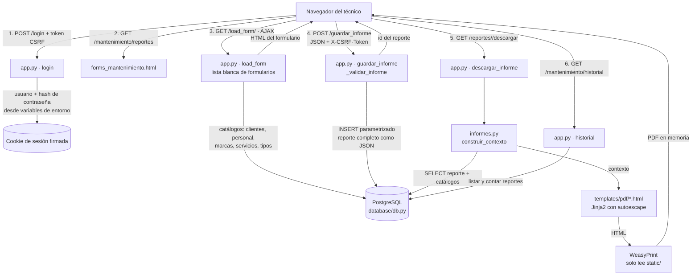
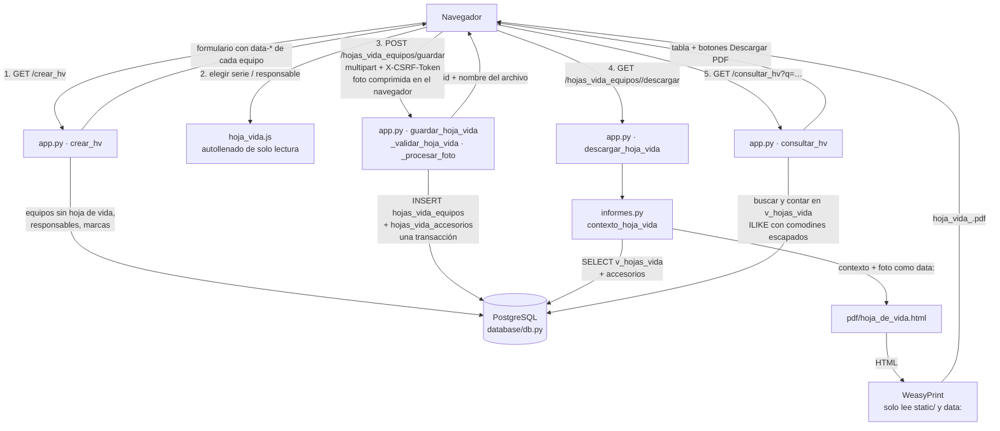
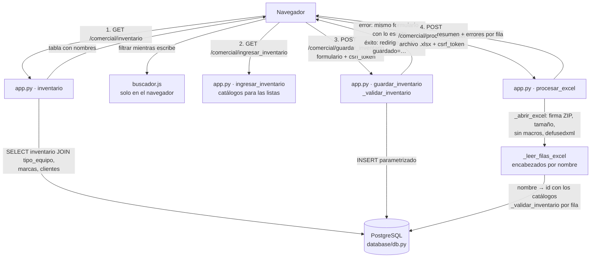

# SISEM — Sistema Integrado de Seguimiento de Equipos Médicos

Aplicación Flask para registrar mantenimientos de equipos biomédicos y las hojas de vida de los equipos
(con descarga de ambos documentos en PDF) y para gestionar el inventario de equipos, ya sea uno por uno
o cargando un archivo Excel.

## Estructura del proyecto

```text
SISEM_PROJECT/
├── app.py                      # Aplicación Flask: configuración, seguridad (sesión, CSRF, cabeceras,
│                               #   límite de intentos de login), manejo de errores y todas las rutas.
│                               #   Valida antes de guardar:
│                               #   · reportes (_validar_informe);
│                               #   · hojas de vida (_validar_hoja_vida, _procesar_foto);
│                               #   · inventario manual (_validar_inventario);
│                               #   · carga de inventario por Excel (_abrir_excel, _leer_filas_excel,
│                               #     _fila_excel_a_formulario, procesar_excel).
├── requirements.txt            # Dependencias de Python con versión fija (formato paquete==versión).
├── Dockerfile                  # Imagen para Render: Python + librerías de sistema de WeasyPrint (Pango),
│                               #   usuario sin privilegios y arranque con gunicorn.
├── render.yaml                 # Blueprint de Render: servicio Docker, /healthz y variables de entorno.
├── Procfile                    # Arranque con gunicorn para plataformas sin Docker (Render no lo usa).
├── .env.example                # Plantilla de variables de entorno (copiar a .env y completar).
├── .env                        # Variables reales (secretos). Solo local; NUNCA se sube al repositorio.
├── .gitignore / .dockerignore  # Archivos que no van a git / a la imagen Docker (.env, venv, cachés…).
│
├── database/
│   ├── __init__.py             # Marca la carpeta como paquete de Python.
│   ├── db.py                   # Acceso a PostgreSQL con pool de conexiones (psycopg). Lee DATABASE_URL o
│   │                           #   db_host/db_user/…
│   │                           #   · Catálogos: clientes, personal, marcas, servicios, tipos de equipo,
│   │                           #     riesgos.
│   │                           #   · Reportes: guardar, leer, listar, contar.
│   │                           #   · Hojas de vida: equipos sin hoja de vida, responsables, guardar
│   │                           #     (hoja + accesorios en una transacción), leer, buscar y contar.
│   │                           #   · Inventario: listado con los nombres de tipo, marca y cliente (JOIN) y
│   │                           #     guardar_inventario (lanza InventarioDuplicado si la serie ya existe).
│   └── postgres/               # Migración de MariaDB a PostgreSQL
│       ├── LEEME.md            # Guía paso a paso de la migración.
│       ├── 00_tipos_en_mariadb.sql   # Consulta los tipos reales de columnas en MariaDB.
│       ├── 01_esquema.sql            # Crea las tablas, claves foráneas e índices en PostgreSQL
│       │                             #   (no incluye las tablas de hojas de vida; ver "Base de datos").
│       ├── 02_ajustar_secuencias.sql # Ajusta los autonuméricos después de copiar los datos.
│       └── 03_verificar.sql          # Cuenta filas por tabla para comparar ambos motores.
│
├── informes/
│   ├── __init__.py             # Marca la carpeta como paquete de Python.
│   └── informes.py             # Generación de los PDF:
│                               #   · Reportes: registro de tipos de equipo (TIPOS_EQUIPO), lectura del
│                               #     reporte, cálculos (bomba, flujos y O2 del concentrador) y lectura de
│                               #     formularios para la plantilla genérica.
│                               #   · Hoja de vida: contexto_hoja_vida, generar_hoja_vida_pdf y el nombre
│                               #     seguro del archivo (hoja_vida_<inventario>.pdf).
│                               #   · _html_a_pdf: conversión HTML → PDF con WeasyPrint, que solo puede
│                               #     leer archivos de static/ (ni internet ni otros archivos del servidor).
│
├── templates/                  # Plantillas Jinja2 (HTML)
│   ├── login.html              # Inicio de sesión (con token CSRF).
│   ├── dashboard.html          # Panel principal con estadísticas (reportes totales, del mes, clientes).
│   ├── clientes.html           # Listado de clientes registrados.
│   ├── historial.html          # Listado paginado de reportes con botón para descargar el PDF.
│   ├── proximamente.html       # Página para los módulos del menú que aún no existen.
│   ├── error.html              # Página de error amigable (sin detalles internos).
│   ├── layout/
│   │   ├── base.html           # Esqueleto común: CSS, meta con token CSRF, menú, cabecera y scripts.
│   │   ├── header.html         # Cabecera: usuario conectado y botón de cerrar sesión (POST).
│   │   ├── sidebar.html        # Menú lateral con los módulos (incluye "Hojas de vida de los equipos").
│   │   └── footer.html         # Pie de página.
│   ├── forms/
│   │   ├── forms_mantenimiento.html          # Página con el selector de formularios.
│   │   ├── form_protocolo_mantenimiento.html # Formulario común: técnico, cliente, equipo, servicio,
│   │   │                                     #   repuestos y estado final (usa los catálogos de la BD).
│   │   ├── form_reporte_general.html         # Aviso: formulario aún no disponible.
│   │   ├── form_consulta.html                # Enlace al historial de reportes.
│   │   ├── hojas_de_vida_equipos.html        # Página del módulo: botones "Nueva hoja de vida" y
│   │   │                                     #   "Consultar hojas de vida".
│   │   ├── hv_equipos/
│   │   │   ├── crear_hoja_vida.html          # Formulario PM_003. El equipo se elige por serie y sus datos
│   │   │   │                                 #   (inventario, nombre, marca, entidad, riesgo) se llenan solos;
│   │   │   │                                 #   el nombre de cada campo es el de la columna en la tabla.
│   │   │   └── consultar_hoja_vida.html      # Búsqueda (serie, inventario, equipo, entidad, marca), tabla
│   │   │                                     #   paginada y botón para descargar el PDF de cada hoja de vida.
│   │   ├── comercial/
│   │   │   ├── inventario.html               # Listado del inventario con nombres (tipo, marca, cliente) y
│   │   │   │                                 #   buscador que filtra la tabla mientras se escribe.
│   │   │   ├── ingresar_inventario.html      # Formulario para registrar un equipo (listas desplegables con
│   │   │   │                                 #   los catálogos); conserva lo escrito si hay un error.
│   │   │   └── cargar_excel.html             # Carga de inventario desde un .xlsx: formato esperado, resumen
│   │   │                                     #   del resultado y tabla con los errores por fila.
│   │   ├── biomedical_form.html              # Borrador antiguo; ninguna ruta lo usa.
│   │   ├── calibration_form.html             # Vacío; ninguna ruta lo usa.
│   │   └── protocolos_mantenimiento/         # Un formulario por tipo de equipo (ids 1-16 de TIPOS_EQUIPO);
│   │       ├── bascula.html                  #   el atributo name de cada campo es la clave que se guarda.
│   │       ├── bomba_infusion.html
│   │       ├── cama_hospitalaria.html
│   │       ├── concentrador_O2.html
│   │       ├── desfibrilador.html
│   │       ├── electrobisturi.html
│   │       ├── electrocardiografo.html
│   │       ├── flujometro.html
│   │       ├── incubadora.html
│   │       ├── maquina_anestesia.html
│   │       ├── monitor_signos_vitales.html
│   │       ├── neveras.html
│   │       ├── oximetro.html
│   │       ├── succionador.html
│   │       ├── tensiometro.html
│   │       └── ventilador.html
│   └── pdf/                    # Plantillas que WeasyPrint convierte en PDF
│       ├── base.html           # Estructura del PDF de los reportes (incluye los estilos).
│       ├── _estilos.css        # Estilo de los reportes: fuente Jost, franjas #66A6BE, bordes grises,
│       │                       #   tamaño de página, numeración y pie de página.
│       ├── _encabezado.html    # Cuadrícula de encabezado: logo, título, proceso, código (PM-0xx) y versión.
│       ├── _cliente.html       # Bloque "Datos del cliente" (institución y área).
│       ├── _equipo.html        # Bloque "Datos del equipo" (marca, modelo, serie, inventario).
│       ├── _servicio.html      # Tipo de servicio (preventivo, correctivo…).
│       ├── _repuestos.html     # Tabla de repuestos (hasta 5).
│       ├── _cierre.html        # Estado final del equipo, firmas y sello.
│       ├── _pie.html           # Elaboró / revisó / aprobó y fecha de aprobación del formato.
│       ├── bomba_infusion.html     # Réplica del formato Word PM-020.
│       ├── concentrador_o2.html    # Réplica del formato Word PM-013.
│       ├── protocolo_generico.html # Resto de equipos (se arma a partir de su formulario).
│       └── hoja_de_vida.html       # Hoja de vida de equipo médico (formato PM_003, una página, con foto).
│
├── static/                     # Archivos públicos que sirve Flask
│   ├── css/
│   │   ├── style.css           # Estilos de la aplicación (incluye los del módulo de hojas de vida: .hv-*).
│   │   └── login.css           # Estilos de la pantalla de inicio de sesión.
│   ├── js/
│   │   ├── app.js              # Común: menú lateral, lectura del token CSRF y descarga del PDF por fetch.
│   │   ├── buscador.js         # Filtra las filas de una tabla mientras se escribe (sin tildes ni mayúsculas).
│   │   │                       #   Reutilizable: <input data-filtro-tabla="id_de_la_tabla">.
│   │   ├── forms.js            # Carga de formularios por AJAX, envío del informe en JSON y descarga del PDF.
│   │   ├── historial.js        # Botones "Descargar PDF" del historial de reportes y de la consulta de
│   │   │                       #   hojas de vida.
│   │   └── hoja_vida.js        # Hoja de vida: autollenado desde el inventario y el personal, vista previa y
│   │                           #   compresión de la foto, guardado y descarga automática del PDF.
│   ├── fonts/                  # Fuente Jost (Regular, Medium, Bold) usada en los PDF.
│   └── images/                 # Íconos SVG del menú, logos (web y PDF) y sello del PDF.
│                               #   paperclip.svg no se usa en ninguna plantilla.
│
├── Formatos/                   # Formatos originales (Word por equipo y "hoja de vida equipo.xlsx"):
│                               #   referencia de diseño, no se usan al ejecutar.
│
├── tests/
│   ├── __init__.py
│   ├── helpers.py              # Entorno de prueba: base de datos simulada (reportes, inventario, hojas de
│   │                           #   vida) y variables de entorno falsas.
│   ├── test_sisem.py           # Pruebas de seguridad, rutas, validación, contenido de los PDF, hojas de
│   │                           #   vida (guardar, validar, duplicados, consultar, PDF), inventario (listado,
│   │                           #   formulario, serie repetida) y carga por Excel (archivos maliciosos incluidos).
│   └── test_db.py              # Pruebas de database/db.py con un pool de conexiones simulado.
│
└── tools/
    └── generar_hash.py         # Pide una contraseña y genera el valor de ADMIN_PASSWORD_HASH.
```

## Rutas

| Ruta                                                 | Método           | Qué hace                                                  |
| ---------------------------------------------------- | ----------------- | ---------------------------------------------------------- |
| `/login`, `/logout`                              | GET/POST, POST    | Inicio y cierre de sesión                                 |
| `/dashboard`, `/clientes`                        | GET               | Panel principal y listado de clientes                      |
| `/mantenimiento/reportes`                          | GET               | Página para generar reportes de mantenimiento             |
| `/load_form/<tipo>`                                | GET (AJAX)        | Devuelve un formulario de la lista blanca                  |
| `/mantenimiento/reportes/guardar_informe`          | POST (JSON)       | Valida y guarda un reporte                                 |
| `/mantenimiento/reportes/<id>/descargar`           | GET               | PDF del reporte                                            |
| `/mantenimiento/historial`                         | GET               | Historial paginado de reportes                             |
| `/mantenimiento/hojas_vida_equipos`                | GET               | Página del módulo de hojas de vida                       |
| `/crear_hv`                                        | GET               | Formulario de nueva hoja de vida                           |
| `/mantenimiento/hojas_vida_equipos/guardar`        | POST (multipart)  | Valida y guarda la hoja de vida y sus accesorios           |
| `/mantenimiento/hojas_vida_equipos/<id>/descargar` | GET               | PDF de la hoja de vida                                     |
| `/consultar_hv?q=…&pagina=…`                     | GET               | Búsqueda y listado de hojas de vida                       |
| `/comercial/inventario`                            | GET               | Listado del inventario con buscador                        |
| `/comercial/ingresar_inventario?guardado=…`       | GET               | Formulario para registrar un equipo (y aviso de guardado)  |
| `/comercial/guardar_inventario`                    | POST (formulario) | Valida y guarda un equipo; redirige al formulario vacío   |
| `/comercial/cargar_excel`                          | GET               | Página para cargar inventario desde un .xlsx              |
| `/comercial/procesar_excel`                        | POST (multipart)  | Valida el archivo y guarda cada fila; muestra el resumen   |
| `/<modulo>/<seccion>`                              | GET               | Módulos del menú aún no implementados ("próximamente") |
| `/healthz`                                         | GET               | Chequeo de salud para Render (sin sesión)                 |

Todas, salvo `/login` y `/healthz`, exigen sesión iniciada. Todos los POST exigen el token CSRF.

## Base de datos

PostgreSQL. Tablas que usa la aplicación:

| Tabla / vista                                                               | Uso                                                                                                                                           |
| --------------------------------------------------------------------------- | --------------------------------------------------------------------------------------------------------------------------------------------- |
| `clientes`, `personal`, `marcas`, `mantenimientos`, `tipo_equipo` | Catálogos (listas desplegables y nombres en los PDF)                                                                                         |
| `riesgo`                                                                  | Clasificaciones del riesgo (`I`, `IIA`, `IIB`, `III`); `inventario.riesgo` guarda el texto                                          |
| `inventario`                                                              | Equipos: tipo, marca, lote, serie, serial interno, cliente, riesgo, INVIMA. **Solo `serie` es única** (restricción `unico_serie`) |
| `reportes`                                                                | Reportes de mantenimiento (ids en columnas + formulario completo como JSON)                                                                   |
| `hojas_vida_equipos`                                                      | Hoja de vida de cada equipo (`id_inventario` único → una por equipo), incluida la foto (`bytea`)                                        |
| `hojas_vida_accesorios`                                                   | Hasta 8 accesorios por hoja de vida (`id_hoja_vida`, `fila` 1-8)                                                                          |
| `v_hojas_vida` (vista)                                                    | Une la hoja de vida con inventario, tipo, marca, cliente y responsable; la usan el PDF y la consulta                                          |

La base de Render es una **copia exacta** de la base local (estructura y datos). Cualquier cambio de estructura
(tablas, columnas, restricciones, vistas) hay que hacerlo en las dos.

`riesgo`, `hojas_vida_equipos`, `hojas_vida_accesorios`, `v_hojas_vida`, las columnas `inventario.invima` y
`personal.telefono` y la restricción `unico_serie` se crearon directamente en la base y **no están en
`database/postgres/01_esquema.sql`**. Para montar una base nueva desde cero, copia la estructura de la base
local (por ejemplo, con *Generate SQL → DDL* de DBeaver) en vez de usar solo ese script.

**Nombres repetidos en los catálogos.** Hoy `tipo_equipo` tiene los 16 tipos dos veces (ids 1-16 y 18-33) y
casi todas las marcas están repetidas, así que las listas desplegables muestran nombres duplicados. La carga
por Excel no se ve afectada: cuando un nombre tiene varios ids usa el **menor** (en `tipo_equipo`, los 1-16 que
usan los formularios y PDF de mantenimiento).

## Flujo de datos

### Reportes de mantenimiento



1. **Inicio de sesión.** `login.html` envía usuario, contraseña y token CSRF a `POST /login`.
   `app.py` compara el usuario con `ADMIN_USER` y la contraseña con `ADMIN_PASSWORD_HASH`. Si son
   correctos, crea una sesión nueva en una cookie firmada con `SECRET_KEY`; si no, cuenta un intento
   fallido para esa IP (5 fallos bloquean 15 minutos). Todas las demás páginas exigen esa sesión.
2. **Selección del formulario.** En *Generar reporte de mantenimiento*, `forms.js` pide por AJAX
   `/load_form/Protocolo_de_mantenimiento`. `app.py` solo acepta nombres de una lista fija, consulta los
   catálogos en PostgreSQL (`db.py`) y devuelve el formulario común con las listas desplegables llenas.
3. **Formulario del equipo.** Al elegir el tipo de equipo, `forms.js` pide `/load_form/<id>` y añade el
   formulario específico (`protocolos_mantenimiento/<equipo>.html`) dentro del común.
4. **Guardado.** Al pulsar *Guardar*, `forms.js` convierte todos los campos en un objeto JSON
   (`{name: valor}`) y lo envía a `POST /mantenimiento/reportes/guardar_informe` con la cabecera
   `X-CSRF-Token`. `app.py` valida que solo haya textos, que no se pasen los límites de tamaño, que
   técnico, cliente y tipo de equipo sean ids numéricos válidos y que la fecha sea real. Después
   `db.subir_reporte` hace un `INSERT` parametrizado en la tabla `reportes`: los ids van en columnas y
   el formulario completo se guarda como JSON en la columna `reporte`. Se devuelve el id nuevo.
5. **PDF.** Con ese id, `app.js` descarga `/mantenimiento/reportes/<id>/descargar`. `informes.py`:
   - lee el reporte y decodifica el JSON;
   - toma el tipo de equipo **del propio reporte** (no de la URL) y busca su entrada en `TIPOS_EQUIPO`;
   - traduce los ids a nombres con los catálogos (cliente, marca, técnico, servicio);
   - calcula los resultados (errores y tolerancias de la bomba, flujos y O2 del concentrador) o, para
     los demás equipos, recorre su formulario HTML para emparejar cada etiqueta con el valor guardado;
   - renderiza la plantilla de `templates/pdf/` (Jinja2 escapa todo el texto del usuario) y WeasyPrint
     la convierte en PDF en memoria. WeasyPrint solo puede leer el logo, el sello y las fuentes de
     `static/`: no accede a internet ni a otros archivos del servidor.
6. **Historial.** `/mantenimiento/historial` lista los reportes (20 por página) desde PostgreSQL y
   permite volver a descargar el PDF de cualquiera con `historial.js`.

### Hojas de vida de equipos



1. **Formulario.** `/crear_hv` muestra solo los equipos del `inventario` que aún **no** tienen hoja de
   vida. Cada opción de serie lleva en atributos `data-*` los datos de **su mismo registro** de inventario.
   Al elegirla, `hoja_vida.js` llena (solo lectura) el N° de inventario, nombre, marca, entidad y
   clasificación del riesgo, y propone el registro INVIMA (editable). Al elegir el responsable se
   muestran su teléfono y correo (tabla `personal`).
2. **Envío.** Al pulsar **Guardar hoja de vida**, el navegador reduce la foto (máx. 1200 px, JPEG,
   ~700 KB) y envía el formulario (`multipart/form-data` + `X-CSRF-Token`) a
   `POST /mantenimiento/hojas_vida_equipos/guardar`. Los campos de solo lectura no se envían.
3. **Validación.** `app.py` (`_validar_hoja_vida`) acepta solo las columnas conocidas, comprueba que el
   equipo, el responsable y las marcas de los accesorios existan, que los valores fijos (periodicidad,
   sí/no, meses 1-12) y las longitudes coincidan con los `CHECK` de la tabla, y que la fecha sea real.
   `_procesar_foto` abre la imagen con Pillow, rechaza lo que no sea JPG/PNG real y la vuelve a codificar
   como JPEG (elimina metadatos como el GPS y cualquier contenido que no sea imagen).
4. **Guardado.** `db.guardar_hoja_vida` inserta en `hojas_vida_equipos` y `hojas_vida_accesorios` en
   **una sola transacción** (si algo falla no queda nada a medias). La foto queda en la columna `foto`
   (`bytea`) junto con `foto_mime` y `foto_nombre`. Como `id_inventario` es único, un segundo intento para
   el mismo equipo responde 409. Nombre, marca, serie, inventario, entidad y riesgo **no se copian**: se
   leen del inventario por `id_inventario`.
5. **PDF automático.** Con el id devuelto, `hoja_vida.js` descarga
   `/mantenimiento/hojas_vida_equipos/<id>/descargar`. `informes.py` lee la vista `v_hojas_vida` y los
   accesorios, inserta la foto en el HTML como `data:image/jpeg;base64,…`, rellena
   `templates/pdf/hoja_de_vida.html` y WeasyPrint genera `hoja_vida_<N° inventario>.pdf`.
6. **Consulta.** `/consultar_hv` lista las hojas de vida (20 por página, más recientes primero). Con
   `?q=` busca, sin distinguir mayúsculas, en serie, N° de inventario, equipo, entidad y marca; los `%`, `_`
   y `\` escritos por el usuario se buscan como texto normal. Cada fila tiene un botón que vuelve a
   generar y descargar el PDF (`historial.js`).

### Inventario de equipos



1. **Listado.** `/comercial/inventario` trae los equipos con una sola consulta que une `inventario` con
   `tipo_equipo`, `marcas` y `clientes`, así la tabla muestra nombres y no ids (`LEFT JOIN`: un equipo sin
   marca aparece con "—"). El buscador (`buscador.js`) oculta en el navegador las filas que no coinciden con
   lo escrito, sin distinguir mayúsculas ni tildes, y avisa cuando no hay coincidencias.
2. **Registro manual.** `/comercial/ingresar_inventario` muestra el formulario con las listas de tipo de
   equipo, marca, cliente y riesgo (catálogos en tuplas: `[0]` es el id y `[1]` el nombre). Al enviarlo,
   `guardar_inventario` pasa los datos por `_validar_inventario`:

   - toma **solo** los 8 campos conocidos y los traduce a columnas (`equipo` → `id_equipo`,
     `interno` → `serial_inventario_interno`, `cliente` → `id_cliente`); el token CSRF y cualquier campo
     extra se ignoran;
   - comprueba que tipo, marca y cliente existan, que el riesgo sea uno de la tabla `riesgo`, y que los textos
     no estén vacíos ni pasen el largo de su columna.

   Si algo falla, vuelve a mostrar el formulario con el mensaje y lo ya escrito. Si la **serie ya existe**,
   PostgreSQL rechaza el `INSERT` (restricción `unico_serie`) y se muestra "Ya existe un equipo con esa
   serie.". Si todo sale bien, redirige al formulario vacío con el aviso "Equipo … guardado" (así recargar la
   página no lo guarda dos veces).
3. **Carga por Excel.** En `/comercial/cargar_excel` se sube un `.xlsx` (máx. 1 MB y 1000 filas).
   `procesar_excel`:

   - revisa el archivo antes de abrirlo (`_abrir_excel`): extensión `.xlsx`, firma ZIP real, tamaño
     descomprimido (máx. 20 MB) y número de archivos internos (máx. 300), y que no traiga macros. `openpyxl`
     lo abre en modo lectura con `defusedxml`, que bloquea los ataques XML, y lee solo valores calculados
     (las fórmulas nunca se ejecutan);
   - lee la fila 1 como encabezado **por nombre**, en cualquier orden (`Tipo de equipo`, `Marca`, `Serie`,
     `Lote`, `Serial de inventario interno`, `Cliente`, `Riesgo`, `INVIMA`) y avisa si falta alguna columna;
   - por cada fila convierte los nombres en ids con los catálogos, sin distinguir mayúsculas ni tildes. Si un
     nombre está repetido en el catálogo, usa el id menor. Rechaza textos que empiezan por `=`, `+` o `@`
     (parecen fórmulas) y aplica la misma `_validar_inventario` del formulario manual;
   - guarda **cada fila por separado**: una fila con error no detiene las demás. El único dato que no se puede
     repetir es la **serie**; lote, serial interno, INVIMA y los demás pueden repetirse.

   La página muestra "N equipos guardados, M filas con error" y una tabla con el número real de la fila en
   Excel y el motivo (hasta 50). Los errores internos solo van al log del servidor.

En todas las respuestas `app.py` agrega cabeceras de seguridad (CSP, `X-Frame-Options`, `nosniff`,
HSTS en HTTPS y `Cache-Control: no-store` en páginas con datos). Si ocurre un error, el detalle queda en
el log del servidor y el usuario solo ve un mensaje genérico (`error.html` o JSON `{"error": ...}`).

## Cómo se generan los PDF

Ya **no** se usa Word ni LibreOffice. Cada documento es una plantilla HTML + CSS (Jinja2) que
se convierte a PDF con WeasyPrint, en memoria y sin archivos temporales.

| Documento                          | Plantilla                                                                                                                           |
| ---------------------------------- | ----------------------------------------------------------------------------------------------------------------------------------- |
| Reporte · 2 – Bomba de infusión | `templates/pdf/bomba_infusion.html` (réplica del formato Word PM-020)                                                            |
| Reporte · 4 – Concentrador de O2 | `templates/pdf/concentrador_o2.html` (réplica del formato Word PM-013)                                                           |
| Reporte · los demás (1-16)       | `templates/pdf/protocolo_generico.html`, construida leyendo el propio formulario de `templates/forms/protocolos_mantenimiento/` |
| Hoja de vida de equipo             | `templates/pdf/hoja_de_vida.html` (formato PM_003, una página)                                                                   |

Piezas compartidas de los reportes: `templates/pdf/base.html`, `_estilos.css`, `_encabezado.html` y los
parciales `_cliente`, `_equipo`, `_repuestos`, `_cierre`, etc. Reportes y hoja de vida usan el mismo estilo
(franjas `#66A6BE`, bordes `#7f8f99`, fuente Jost). El código está en `informes/informes.py`.

El PDF del reporte toma el tipo de equipo del propio reporte guardado, no de la URL.

La **fecha de aprobación** del formato PM_003 se escribe en `FECHA_APROBACION_HV` (`informes/informes.py`).

### Agregar o completar un equipo

1. Completa su formulario en `templates/forms/protocolos_mantenimiento/<equipo>.html`
   (títulos `<h3>` = secciones; el atributo `name` de cada campo es la clave que se guarda).
2. Listo: su PDF sale con la plantilla genérica. Si quieres un diseño propio (como bomba y concentrador),
   crea `templates/pdf/<equipo>.html`, una función `_contexto_<equipo>` en `informes.py` y apunta a ella en `TIPOS_EQUIPO`.
3. El código/versión del protocolo (PM-0xx) se edita en `TIPOS_EQUIPO`.

## Ejecutar en tu computador

```bash
python -m venv venv && source venv/bin/activate      # Windows: venv\Scripts\activate
pip install -r requirements.txt
cp .env.example .env                                  # y complétalo
python tools/generar_hash.py                          # genera ADMIN_PASSWORD_HASH
python app.py
```

WeasyPrint necesita Pango. En Windows instala el runtime GTK (ver documentación de WeasyPrint);
en Linux: `sudo apt install libpango-1.0-0 libpangoft2-1.0-0 libharfbuzz-subset0`.

Con `FLASK_DEBUG=false` el servidor no se recarga solo: reinícialo después de cambiar el código.

## Pruebas

```bash
python -m unittest discover -s tests -t . -v
```

Usan una base de datos simulada; no necesitan PostgreSQL. Cubren login, CSRF, validación, cabeceras,
cálculos del informe, el HTML de los 16 tipos de equipo, el módulo de hojas de vida (guardado con foto y
accesorios, validaciones, duplicados, consulta, nombre del archivo y restricciones del generador de PDF), el
inventario (listado con nombres y buscador, formulario, validaciones, serie repetida) y la carga por Excel
(nombres sin tildes ni mayúsculas, encabezados en otro orden, errores por fila y archivos rechazados: texto
renombrado, bomba ZIP, macros, bomba XML, más de 1000 filas, sin CSRF).
**No** generan el PDF final (eso lo hace WeasyPrint): después de desplegar, descarga un PDF de cada
documento para revisar el diseño.

## Desplegar en Render

1. Subir el proyecto a un repositorio **sin** el `.env` (ya está en `.gitignore`).
2. Crear un *Web Service* con runtime **Docker** (o usar `render.yaml`).
3. Definir las variables de entorno de `.env.example` en el panel de Render
   (`SECRET_KEY`, `ADMIN_USER`, `ADMIN_PASSWORD_HASH`, `DATABASE_URL`, `TRUST_PROXY=1`, `FLASK_DEBUG=false`).
4. El chequeo de salud es `/healthz`.

La base de datos es **PostgreSQL** y la de Render es una copia exacta de la local. En Render, `DATABASE_URL`
debe ser la *Internal Database URL* de esa base. Si se usa `render.yaml` como Blueprint, revisa su bloque
`databases`: está pensado para que Render cree una base nueva, así que con una base creada a mano hay que
quitarlo (y la parte `fromDatabase` de `DATABASE_URL`) para no conectar la app a una base vacía.

`requirements.txt` incluye `openpyxl` (lectura de Excel) y `defusedxml` (protección XML): sin ellos la app no
arranca o la carga por Excel queda sin protección. La guía para migrar desde MariaDB (esquema, copia de datos
con DBeaver y verificación) está en `database/postgres/LEEME.md`.

## Seguridad: qué se hizo

- Contraseña verificada con hash (`ADMIN_PASSWORD_HASH`, scrypt) y comparación en tiempo constante; ya no se compara texto plano.
- Bloqueo temporal tras 5 intentos fallidos de login por IP (en memoria, por proceso de gunicorn).
- Protección CSRF en todos los POST (formularios y AJAX); cierre de sesión por POST.
- Cookie de sesión `HttpOnly`, `SameSite=Lax` y `Secure` (en producción); sesión nueva al iniciar sesión; expira por inactividad.
- Cabeceras: Content-Security-Policy estricta (sin scripts inline), `X-Frame-Options`, `nosniff`, HSTS, `Cache-Control: no-store`.
- `SECRET_KEY` obligatoria en producción; `FLASK_DEBUG` apagado por defecto (antes estaba **encendido**).
- Validación en el servidor de reportes, hojas de vida e inventario (tipos, longitudes, fechas, valores permitidos, ids existentes, tamaño máximo de 1 MB por envío). Los formularios solo aceptan los campos conocidos; el resto se ignora.
- Carga por Excel: solo `.xlsx` con firma ZIP real, límite de tamaño descomprimido y de archivos internos (contra bombas ZIP), sin macros, `defusedxml` contra ataques XML, sin ejecutar fórmulas, rechazo de textos que empiezan por `=`, `+` o `@`, máximo 1000 filas y la misma validación del formulario manual en cada fila.
- Fotos de las hojas de vida revisadas y recodificadas con Pillow (sin metadatos ni contenido que no sea imagen).
- Los errores ya no devuelven `str(e)` al navegador (podía filtrar datos de la base); se registran en el log.
- Consultas SQL parametrizadas con pool de conexiones (PostgreSQL); en las búsquedas, los comodines del usuario se escapan.
- Plantillas con autoescape (el contenido del usuario no se interpreta como HTML ni en la web ni en el PDF).
- WeasyPrint solo puede leer archivos de `static/` y datos `data:`: un dato malicioso no puede hacer que el servidor descargue URLs ni lea otros archivos.
- Contenedor Docker sin privilegios de root.

## Pendiente

- Completar los módulos pendientes del aplicativo.
- Escribir la fecha de aprobación del formato PM_003 en `FECHA_APROBACION_HV`.
- Agregar a los scripts de `database/postgres/` la estructura creada a mano (`riesgo`, `hojas_vida_equipos`, `hojas_vida_accesorios`, `v_hojas_vida`, `inventario.invima`, `personal.telefono`, `unico_serie`).
- Limpiar los nombres repetidos de `tipo_equipo`, `marcas` y `clientes` (conservando en `tipo_equipo` los ids 1-16).
- Si el inventario crece a miles de equipos, pasar el buscador del navegador a una búsqueda paginada en el servidor (como en la consulta de hojas de vida).
