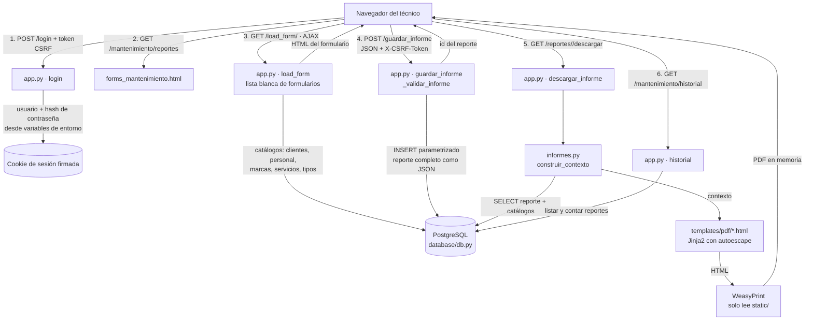

# SISEM — Sistema Integrado de Seguimiento de Equipos Médicos

Aplicación Flask para registrar mantenimientos de equipos biomédicos y descargar el informe en PDF.

## Estructura del proyecto

```text
SISEM_PROJECT/
├── app.py                      # Aplicación Flask: configuración, seguridad (sesión, CSRF, cabeceras,
│                               #   límite de intentos de login), manejo de errores, rutas y validación
│                               #   de los informes antes de guardarlos.
├── requirements.txt            # Dependencias de Python con versión fija (formato paquete==versión).
├── Dockerfile                  # Imagen para Render: Python + librerías de sistema de WeasyPrint (Pango),
│                               #   usuario sin privilegios y arranque con gunicorn.
├── render.yaml                 # Blueprint de Render: servicio Docker, /healthz y variables de entorno.
├── Procfile                    # Arranque con gunicorn para plataformas sin Docker (Render no lo usa).
├── .env.example                # Plantilla de variables de entorno (copiar a .env y completar).
├── .env                        # Variables reales (secretos). Solo local; NUNCA se sube al repositorio.
├── .gitignore / .dockerignore  # Archivos que no van a git / a la imagen Docker (.env, venv, cachés…).
│
├── database/
│   ├── __init__.py             # Marca la carpeta como paquete de Python.
│   ├── db.py                   # Acceso a PostgreSQL con pool de conexiones (psycopg). Lee DATABASE_URL o
│   │                           #   db_host/db_user/…; catálogos (clientes, personal, marcas, servicios,
│   │                           #   tipos de equipo) y reportes (guardar, leer, listar, contar).
│   └── postgres/               # Migración de MariaDB a PostgreSQL
│       ├── LEEME.md            # Guía paso a paso de la migración.
│       ├── 00_tipos_en_mariadb.sql   # Consulta los tipos reales de columnas en MariaDB.
│       ├── 01_esquema.sql            # Crea las tablas, claves foráneas e índices en PostgreSQL.
│       ├── 02_ajustar_secuencias.sql # Ajusta los autonuméricos después de copiar los datos.
│       └── 03_verificar.sql          # Cuenta filas por tabla para comparar ambos motores.
│
├── informes/
│   ├── __init__.py             # Marca la carpeta como paquete de Python.
│   └── informes.py             # Generación del PDF: registro de tipos de equipo (TIPOS_EQUIPO), lectura
│                               #   del reporte guardado, cálculos (errores de bomba, flujos y O2 del
│                               #   concentrador), lectura de formularios para la plantilla genérica y
│                               #   conversión HTML → PDF con WeasyPrint (solo puede leer archivos de static/).
│
├── templates/                  # Plantillas Jinja2 (HTML)
│   ├── login.html              # Inicio de sesión (con token CSRF).
│   ├── dashboard.html          # Panel principal con estadísticas (reportes totales, del mes, clientes).
│   ├── clientes.html           # Listado de clientes registrados.
│   ├── historial.html          # Listado paginado de reportes con botón para descargar el PDF.
│   ├── proximamente.html       # Página para los módulos del menú que aún no existen.
│   ├── error.html              # Página de error amigable (sin detalles internos).
│   ├── layout/
│   │   ├── base.html           # Esqueleto común: CSS, meta con token CSRF, menú, cabecera y scripts.
│   │   ├── header.html         # Cabecera: usuario conectado y botón de cerrar sesión (POST).
│   │   ├── sidebar.html        # Menú lateral con los módulos.
│   │   └── footer.html         # Pie de página.
│   ├── forms/
│   │   ├── forms_mantenimiento.html          # Página con el selector de formularios.
│   │   ├── form_protocolo_mantenimiento.html # Formulario común: técnico, cliente, equipo, servicio,
│   │   │                                     #   repuestos y estado final (usa los catálogos de la BD).
│   │   ├── form_reporte_general.html         # Aviso: formulario aún no disponible.
│   │   ├── form_consulta.html                # Enlace al historial de reportes.
│   │   ├── biomedical_form.html              # Borrador antiguo; ninguna ruta lo usa.
│   │   ├── calibration_form.html             # Vacío; ninguna ruta lo usa.
│   │   └── protocolos_mantenimiento/         # Un formulario por tipo de equipo (ids 1-16 de TIPOS_EQUIPO);
│   │       ├── bascula.html                  #   el atributo name de cada campo es la clave que se guarda.
│   │       ├── bomba_infusion.html
│   │       ├── cama_hospitalaria.html
│   │       ├── concentrador_O2.html
│   │       ├── desfibrilador.html
│   │       ├── electrobisturi.html
│   │       ├── electrocardiografo.html
│   │       ├── flujometro.html
│   │       ├── incubadora.html
│   │       ├── maquina_anestesia.html
│   │       ├── monitor_signos_vitales.html
│   │       ├── neveras.html
│   │       ├── oximetro.html
│   │       ├── succionador.html
│   │       ├── tensiometro.html
│   │       └── ventilador.html
│   └── pdf/                    # Plantillas que WeasyPrint convierte en PDF
│       ├── base.html           # Estructura del documento PDF (incluye los estilos).
│       ├── _estilos.css        # Colores, fuente Jost, tamaño de página y pie de página del PDF.
│       ├── _encabezado.html    # Logo, título del protocolo, código (PM-0xx) y versión.
│       ├── _cliente.html       # Bloque "Datos del cliente" (institución y área).
│       ├── _equipo.html        # Bloque "Datos del equipo" (marca, modelo, serie, inventario).
│       ├── _servicio.html      # Tipo de servicio (preventivo, correctivo…).
│       ├── _repuestos.html     # Tabla de repuestos (hasta 5).
│       ├── _cierre.html        # Estado final del equipo, firmas y sello.
│       ├── _pie.html           # Elaboró / revisó / aprobó y fecha de aprobación del formato.
│       ├── bomba_infusion.html     # Réplica del formato Word PM-020.
│       ├── concentrador_o2.html    # Réplica del formato Word PM-013.
│       └── protocolo_generico.html # Resto de equipos (se arma a partir de su formulario).
│
├── static/                     # Archivos públicos que sirve Flask
│   ├── css/
│   │   ├── style.css           # Estilos de la aplicación.
│   │   └── login.css           # Estilos de la pantalla de inicio de sesión.
│   ├── js/
│   │   ├── app.js              # Común: menú lateral, lectura del token CSRF y descarga del PDF por fetch.
│   │   ├── forms.js            # Carga de formularios por AJAX, envío del informe en JSON y descarga del PDF.
│   │   └── historial.js        # Botones de descarga del PDF en el historial.
│   ├── fonts/                  # Fuente Jost (Regular, Medium, Bold) usada en el PDF.
│   └── images/                 # Íconos SVG del menú, logos (web y PDF) y sello del PDF.
│                               #   paperclip.svg no se usa en ninguna plantilla.
│
├── Formatos/                   # Formatos Word originales: referencia de diseño, no se usan al ejecutar.
│
├── tests/
│   ├── __init__.py
│   ├── helpers.py              # Entorno de prueba: base de datos simulada y variables de entorno falsas.
│   ├── test_sisem.py           # Pruebas de seguridad, rutas, validación y contenido de los PDF.
│   └── test_db.py              # Pruebas de database/db.py con un pool de conexiones simulado.
│
└── tools/
    └── generar_hash.py         # Pide una contraseña y genera el valor de ADMIN_PASSWORD_HASH.
```

## Flujo de datos



Paso a paso:

1. **Inicio de sesión.** `login.html` envía usuario, contraseña y token CSRF a `POST /login`.
   `app.py` compara el usuario con `ADMIN_USER` y la contraseña con `ADMIN_PASSWORD_HASH`. Si son
   correctos, crea una sesión nueva en una cookie firmada con `SECRET_KEY`; si no, cuenta un intento
   fallido para esa IP (5 fallos bloquean 15 minutos). Todas las demás páginas exigen esa sesión.
2. **Selección del formulario.** En *Generar reporte de mantenimiento*, `forms.js` pide por AJAX
   `/load_form/Protocolo_de_mantenimiento`. `app.py` solo acepta nombres de una lista fija, consulta los
   catálogos en PostgreSQL (`db.py`) y devuelve el formulario común con las listas desplegables llenas.
3. **Formulario del equipo.** Al elegir el tipo de equipo, `forms.js` pide `/load_form/<id>` y añade el
   formulario específico (`protocolos_mantenimiento/<equipo>.html`) dentro del común.
4. **Guardado.** Al pulsar *Guardar*, `forms.js` convierte todos los campos en un objeto JSON
   (`{name: valor}`) y lo envía a `POST /mantenimiento/reportes/guardar_informe` con la cabecera
   `X-CSRF-Token`. `app.py` valida que solo haya textos, que no se pasen los límites de tamaño, que
   técnico, cliente y tipo de equipo sean ids numéricos válidos y que la fecha sea real. Después
   `db.subir_reporte` hace un `INSERT` parametrizado en la tabla `reportes`: los ids van en columnas y
   el formulario completo se guarda como JSON en la columna `reporte`. Se devuelve el id nuevo.
5. **PDF.** Con ese id, `app.js` descarga `/mantenimiento/reportes/<id>/descargar`. `informes.py`:
   - lee el reporte y decodifica el JSON;
   - toma el tipo de equipo **del propio reporte** (no de la URL) y busca su entrada en `TIPOS_EQUIPO`;
   - traduce los ids a nombres con los catálogos (cliente, marca, técnico, servicio);
   - calcula los resultados (errores y tolerancias de la bomba, flujos y O2 del concentrador) o, para
     los demás equipos, recorre su formulario HTML para emparejar cada etiqueta con el valor guardado;
   - renderiza la plantilla de `templates/pdf/` (Jinja2 escapa todo el texto del usuario) y WeasyPrint
     la convierte en PDF en memoria. WeasyPrint solo puede leer el logo, el sello y las fuentes de
     `static/`: no accede a internet ni a otros archivos del servidor.
6. **Historial.** `/mantenimiento/historial` lista los reportes (20 por página) desde PostgreSQL y
   permite volver a descargar el PDF de cualquiera con `historial.js`.

En todas las respuestas `app.py` agrega cabeceras de seguridad (CSP, `X-Frame-Options`, `nosniff`,
HSTS en HTTPS y `Cache-Control: no-store` en páginas con datos). Si ocurre un error, el detalle queda en
el log del servidor y el usuario solo ve un mensaje genérico (`error.html` o JSON `{"error": ...}`).

## Cómo se generan los PDF

Ya **no** se usa Word ni LibreOffice. Cada informe es una plantilla HTML + CSS (Jinja2) que
se convierte a PDF con WeasyPrint, en memoria y sin archivos temporales.

| Tipo de equipo          | Plantilla                                                                                                                           |
| ----------------------- | ----------------------------------------------------------------------------------------------------------------------------------- |
| 2 – Bomba de infusión | `templates/pdf/bomba_infusion.html` (réplica del formato Word)                                                                   |
| 4 – Concentrador de O2 | `templates/pdf/concentrador_o2.html` (réplica del formato Word)                                                                  |
| Los demás (1-16)       | `templates/pdf/protocolo_generico.html`, construida leyendo el propio formulario de `templates/forms/protocolos_mantenimiento/` |

Piezas compartidas: `templates/pdf/base.html`, `_estilos.css` (colores, fuente Jost, pie de página)
y los parciales `_cliente`, `_equipo`, `_repuestos`, `_cierre`, etc. El código está en `informes/informes.py`.

El PDF toma el tipo de equipo del propio reporte guardado, no de la URL.

### Agregar o completar un equipo

1. Completa su formulario en `templates/forms/protocolos_mantenimiento/<equipo>.html`
   (títulos `<h3>` = secciones; el atributo `name` de cada campo es la clave que se guarda).
2. Listo: su PDF sale con la plantilla genérica. Si quieres un diseño propio (como bomba y concentrador),
   crea `templates/pdf/<equipo>.html`, una función `_contexto_<equipo>` en `informes.py` y apunta a ella en `TIPOS_EQUIPO`.
3. El código/versión del protocolo (PM-0xx) se edita en `TIPOS_EQUIPO`.

## Ejecutar en tu computador

```bash
python -m venv venv && source venv/bin/activate      # Windows: venv\Scripts\activate
pip install -r requirements.txt
cp .env.example .env                                  # y complétalo
python tools/generar_hash.py                          # genera ADMIN_PASSWORD_HASH
python app.py
```

WeasyPrint necesita Pango. En Windows instala el runtime GTK (ver documentación de WeasyPrint);
en Linux: `sudo apt install libpango-1.0-0 libpangoft2-1.0-0 libharfbuzz-subset0`.

## Pruebas

```bash
python -m unittest discover -s tests -t . -v
```

Usan una base de datos simulada; no necesitan PostgreSQL. Cubren login, CSRF, validación, cabeceras,
cálculos del informe y el HTML de los 16 tipos de equipo. **No** generan el PDF final (eso lo hace WeasyPrint):
después de desplegar, descarga un PDF de cada equipo para revisar el diseño.

## Desplegar en Render

1. Sube el proyecto a un repositorio **sin** el `.env` (ya está en `.gitignore`).
2. Crea un *Web Service* con runtime **Docker** (o usa `render.yaml`).
3. Define las variables de entorno de `.env.example` en el panel de Render
   (`SECRET_KEY`, `ADMIN_USER`, `ADMIN_PASSWORD_HASH`, `DATABASE_URL`, `TRUST_PROXY=1`, `FLASK_DEBUG=false`).
4. El chequeo de salud es `/healthz`.

La base de datos es **PostgreSQL**. En Render define `DATABASE_URL` con la *Internal Database URL* de tu base.
La guía para migrar desde MariaDB (esquema, copia de datos con DBeaver y verificación) está en `database/postgres/LEEME.md`.

## Seguridad: qué se hizo

- Contraseña verificada con hash (`ADMIN_PASSWORD_HASH`, scrypt) y comparación en tiempo constante; ya no se compara texto plano.
- Bloqueo temporal tras 5 intentos fallidos de login por IP (en memoria, por proceso de gunicorn).
- Protección CSRF en todos los POST (formularios y AJAX); cierre de sesión por POST.
- Cookie de sesión `HttpOnly`, `SameSite=Lax` y `Secure` (en producción); sesión nueva al iniciar sesión; expira por inactividad.
- Cabeceras: Content-Security-Policy estricta (sin scripts inline), `X-Frame-Options`, `nosniff`, HSTS, `Cache-Control: no-store`.
- `SECRET_KEY` obligatoria en producción; `FLASK_DEBUG` apagado por defecto (antes estaba **encendido**).
- Validación del informe en el servidor (tipos, longitudes, fecha, tipo de equipo, tamaño máximo de 1 MB).
- Los errores ya no devuelven `str(e)` al navegador (podía filtrar datos de la base); se registran en el log.
- Consultas SQL parametrizadas con pool de conexiones (PostgreSQL); plantillas con autoescape (el contenido del usuario no se interpreta como HTML en el PDF).
- Contenedor Docker sin privilegios de root.

## Pendiente

- Completar los módulos pendientes del aplicativo
